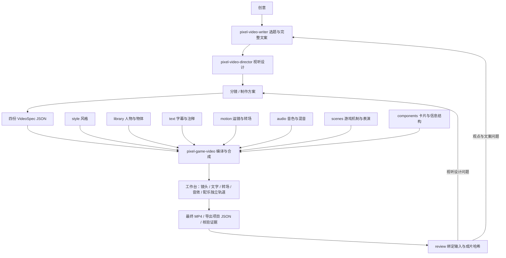

# Codex Skills

非3D运镜从[导演统一选型](skills/pixel-game-video/modules/motion/library.html)选型：实际动画、共用曲线与可复制工程JSON。调用[短促相机、关键帧、图层组与页面接续](skills/pixel-game-video/modules/motion/recipes/pulse-camera.md)，复用同源Canvas执行器接入工作台。[八段试样](skills/pixel-game-video/examples/pulse-motion/README.md)保留创作输入；原生Remotion范围不变。移植来源与AGPL许可见[NOTICE](skills/pixel-game-video/modules/motion/FRAMETELL-NOTICE.md)，随独立交付保留。

像素游戏感视频体系。日常使用三个 skill：编剧负责选题与完整文案，导演负责视听设计与制作统筹，基础 skill 负责执行；运镜转场的实现维护在基础制作模块。

本次及后续版本更新见[变更记录](CHANGELOG.md)。组件完整集合与朴素原版入口见[组件范例集](skills/pixel-game-video/modules/components/examples/style-atlas/README.md)。

七大模块的职责、现有文件归属与后续迁移项见[模块架构清单](skills/pixel-game-video/references/module-ownership.md)。模块 GUIDE 已统一为职责边界、任务路由与验收重点；背景资源、配套布局和人物事件执行器已按归属迁移；现有素材 ID 与 VideoSpec 字段保持兼容。

[统一能力目录](skills/pixel-game-video/references/capability-catalog.md)通过 `catalog --capabilities` 汇总七模块的后端范围、编辑/导出边界、示例与测试入口；旧 `catalog` 查询保持兼容，目录检查不代表测试或审片通过。

新视频先由[编剧](skills/pixel-video-writer/SKILL.md)讨论并确认受众、问题和价值，确认叙事后尽早交完整文案并自查；只要文案可在此交付。需要视听设计时由[导演](skills/pixel-video-director/SKILL.md)接手同一稿，按[导演四阶段](skills/pixel-video-director/references/director-workflow.md)拆大模块、大白话与可弃用构思草图，再共同迭代结构化设计和动态白模，最后统筹正式制作与审片；需要成片再交基础制作。[协作合同](skills/pixel-video-writer/references/handoff.md)定义按需加载、跨安装定位、版本和修订分工。已有[入口与项目 JSON](skills/pixel-video-director/references/script-creator.md)保留，页面改为编剧视图与导演四阶段；旧阶段字段兼容，不因交接另建项目。工作台默认一次看一段，完整维度按需展开，支持[白模播放与 WebM 导出](skills/pixel-video-director/references/director-project.md)。

导演与制作 SKILL.md 现按“任务选择 → 七模块 → 创作/制作约束”组织。具体参数、系列偏好与案例留在对应参考中按需读取；入口与规则的对应关系见[职责清单](skills/pixel-game-video/references/module-ownership.md#技能入口与详细规则)。

| Skill | 职责 |
| --- | --- |
| [pixel-game-video](skills/pixel-game-video/SKILL.md) | 按结构化工程制作视频，强制工作台分轨剪辑与最终导出；Canvas runtime 与有限原生 Remotion 场景共用编辑交付 |
| [pixel-video-writer](skills/pixel-video-writer/SKILL.md) | 讨论选题、确认叙事路线、交付完整文案并检查内容依据；可独立交付，不要求分镜或制作工具 |
| [pixel-video-director](skills/pixel-video-director/SKILL.md) | 接手当前文案，设计全片视听体验与分镜，统筹试样、制作交接、创作审片和定向修复 |

画面叙事方法已整合进导演技能，包括视觉母题、光影与尺度、镜头和主体运动的区分、前后场景的语义承接。参考片的黑金配色、人物和 RPG 界面按新主题选择；[《深度工作》观片案例](skills/pixel-video-director/references/deep-work-case.md)仅是学习笔记，不代表基础层已实现其中所有效果。

分析参考片或设计整段内容时，先确定 [观点如何递进](skills/pixel-video-director/references/visual-storytelling.md#先确定整段如何推进理解)，再选逐镜画面。[《欲望合同》片段复盘](skills/pixel-video-director/references/desire-contract-case.md)记录本次真实观察、与现有作品的对照及未实施的迁移草案；参考的道具和段落顺序不作为模板。

> 使用 $pixel-video-director，先把这段文案演成具体画面，写出主体动作、构图光影、运镜、前后转场和需要准备的素材，只交付视觉分镜。

基础工程只维护四份 JSON，不复制整个引擎。运镜、配色和音效各在自己的模块维护，各技能 `SKILL.md` 只保留使用入口和按需链接。纯视觉方案按 [分镜交接与工程映射](skills/pixel-video-director/references/visual-storyboard.md)编写；进入工程后，初始时间由 storyboard.json 维护；进入工作台编辑后，项目 JSON 保存独立剪辑分支，不自动回写导演源。

制作视频必须在 [本地工作台](skills/pixel-game-video/references/workbench.md) 完成剪辑并导出最终成片。镜头、字幕与其他文字、转场、音效、配乐分别成轨，有旁白时另轨；交付 MP4 与该次导出项目 JSON。现有 Canvas 场景、组件、背景/replacement、人物事件姿态和转场通过同源逐帧 runtime 接入，场景内部配置通过 props 编辑，叙事进度另设叠加单元。它们没有因此全部重写成 React。

`renderBackend=remotion` 仍只选择原生 React 场景：书桌、整体相机轨迹与书页遮挡转场；其白名单与 [Remotion 说明](skills/pixel-game-video/references/remotion.md) 保持一致。[12 秒书桌样例](skills/pixel-video-director/examples/remotion-focus-desk/README.md) 可用于原生执行器调试。两种后端均从同一编译时间线生成工作台初始项目，直接 `render` 用于源合成调试及一致性对照。

全流程的[留存与情绪认知目标](skills/pixel-video-writer/references/audience-experience.md)与[叙事设计及参考](skills/pixel-video-writer/references/narrative-design.md)现由编剧技能唯一维护，导演从项目继承；开头、核心、收尾整体确认，指标与观众体验持续传递到制作和复盘。

## 要求与经验入口

制作、续作或复盘先读 [制作总则与经验入口](skills/pixel-game-video/references/production-principles.md)，再按范围读取下列记录。三个视频 skill 按当前任务接入此入口；编剧独立安装不要求渲染依赖。

| 记录 | 管什么 |
| --- | --- |
| [仓库维护约定](AGENTS.md) | 文件归属、技能独立与维护验证 |
| [核心要求与常见踩坑](skills/pixel-game-video/references/production-principles.md) | 现行通用要求、必须规避的问题与反馈沉淀方式；制作先读 |
| [计算机口播系列偏好](skills/pixel-video-director/references/computing-voiceover.md) | 这个系列的画风、人物职责、背景、叙事与声音方向 |
| [情境插画参考与创作源](skills/pixel-video-director/references/character-illustration.md) | 完整情境插画、文案改编、原图与提示词；[基础层看图与运行指南](skills/pixel-game-video/modules/scenes/whole-illustration.md) |
| 每片的 brief.json / review.json | 本片目标、时长、约束及实际审片证据 |
| [迭代记录](skills/pixel-game-video/references/iteration-history.md) | 历次反馈、有效方法、失败和撤回原因，保留各自适用范围 |

制作中收到吐槽先记本片问题并修复；用户明确满意后主动提炼适用经验，更新总则或所属模块，同类项合并，原话、修复版本和认可证据留历史。用户明确的新要求可立即生效；系列/单片限制不泛化，历史认可不代替本次验证。

## 当前交付基线

场景美术按 [八类画风](skills/pixel-game-video/modules/style/PIXEL-STYLES.md) 选型，v3 保留颗粒、形状、细节、色阶、轮廓、光影、投影七项描述，细化八类核心与人物/物种/道具画法；画廊与命令行共用提示词展开。[主画风与片段透传合同](skills/pixel-game-video/modules/style/ART-DIRECTION-CONTRACT.md) 规定项目主画风、片段可特选、片段内统一继承；组件独立。[画廊](skills/pixel-game-video/modules/style/references/index.html) 保留原整景/局部参考，另补可爱与粗像素的完整干净背景对照，待用户审美确认。八类方向及原物种样板的既有认可范围保留；新参考、运行时预设和动画能力分别验收。

| 维度 | 已收纳内容与边界 |
| --- | --- |
| 视觉方法与组件 | 脚本阶段明确解释任务；12类组件覆盖身份、数值、对比、标注、章节、流程、时间轴、清单、层级、条形比较、代码与结论，可按主次组合 |
| 可变背景与片段替换 | 按内容先设计空间与尺度，再复用或制作项目素材；样板只作质感参考，已有房间不构成场所菜单。素材变更参与哈希与导出，默认保留字幕和旁白时序 |
| 风格与人物 | 项目主画风＋片段特选的八类场景画风，组件独立；[已确认 V3 人物库](skills/pixel-game-video/modules/library/CHARACTERS.md)保留无围巾主角、三位差异化像素配角和一位半身专题配角，含人设与30张动作参考；Canvas 通用人物层可按事件切换姿态，Remotion 当前使用静态基准图 |
| 完整情境插画 | 7张完整场景姿态、生成提示词与独立样例；拆头试样已撤回，新插画仍待用户审美反馈 |
| 转场 | 12种方法：9种通用配方＋3种空间设计；后三种已在竞赛场景落地，尚非通用recipe |
| 节奏与构图 | 定位→主运动→落稳→阅读；全画幅统一镜头、卡片保持固有比例，按旁白与信息量留停顿 |
| 游戏反馈 | 焦点锁定、触点回弹、资源转移、状态确认、阶段进度、任务结算，共6类 |
| 音效 | [九种正式音效](skills/pixel-game-video/modules/audio/ARCADE.md)：原六种加轻确认、焦点、逐层展开；先判断发声必要性，蓄力等撤回实验不参与正式可选库 |
| 配乐 | Canvas 与 Remotion 共用可选 BGM 混音，支持音量、淡入淡出、截取/循环和旁白压低；内置 Chill Wave 与来源署名，见[配乐工作流](skills/pixel-game-video/modules/audio/MUSIC.md) |
| 工作台与交付 | 镜头、文字、转场、音效、配乐独立编辑轨道，旁白按需另轨；强制工作台剪辑与最终导出，交付 MP4 与同次项目 JSON，独立运行快照按需提供；当前技术核验与视听 review 分别记录 |

竞赛视频沿用已获正向反馈的 V6 视觉／V8 音画基线。32秒、筹码数量和试练天数属于该片示例；人物、题材偏好按项目记录，不推广为全部技能的固定条件。本轮停止音效探索，以现有已确认内容准备输出。认可范围及撤回原因集中在 [迭代记录](skills/pixel-game-video/references/iteration-history.md)。

设计转场从 [转场库](skills/pixel-game-video/modules/motion/TRANSITIONS.md) 进入：按交接关系查已实现配方和参考设计，明确实现状态，再安排动作与阅读节奏。

新脚本先按 [视觉表达方法](skills/pixel-video-director/references/visual-system.md) 选择场景或组件，再安排主体变化。[信息组件看图指南](skills/pixel-game-video/modules/components/INFORMATION-COMPONENTS.md) 提供十二类信息结构的实渲染总览、逐类大图、状态对照与组合参考，图片对应的独立示例随基础 skill 分发；[背景基调与样板](skills/pixel-game-video/modules/style/ART-DIRECTION.md) 用于创作新素材；[按镜头替换](skills/pixel-video-director/references/media-replacement.md) 提供可校验的导入入口。导演创作源示例在 [基础五类](skills/pixel-video-director/examples/component-system/brief.json) 与 [新增七类及组合](skills/pixel-video-director/examples/component-expansion/brief.json)。

[完整插画进入视频](skills/pixel-game-video/modules/scenes/whole-illustration.md) 保留完整场景状态对照与8.4秒独立样例。导演层维护镜头事件、插画原图与提示词，编排脚本生成片段、同步脚本生成基础层快照并记录哈希；基础层按既有 replacement 合同运行，核心入口只路由。旧拆头拼身试样撤回，不继续作为推荐案例。

增强局部游戏感从 [游戏反馈细节库](skills/pixel-game-video/modules/scenes/GAME_FEEL.md) 进入：收纳六类反馈及已获认可的竞赛视频实例，关联触发状态、动作、声音和验收；与转场分开维护。

将 `skills/pixel-game-video/` 完整复制到 Codex 的 skills 目录即可单独使用。编剧可只复制 `skills/pixel-video-writer/` 独立写稿。需要导演工具时安装 `skills/pixel-video-director/`；制作时另安装基础技能。跨技能按显式目录、对应变量、同级目录和 Codex skills 目录定位，详见[协作合同](skills/pixel-video-writer/references/handoff.md)。旧导演参考路径保留路由，原工程命令与项目 ID 不变。

> 使用 $pixel-video-writer，先讨论并确认这个选题帮谁、解决什么问题、提供什么价值，再确认叙事并写出完整文案。

> 使用 $pixel-video-director，接手当前完整文案与确认记录，完成视听设计，继续统筹像素视频制作与有证据的 review。

> 使用 $pixel-game-video，在现有工程的第二镜加入碎屏转场，按源文件修改并验证该片段。

运行依赖与命令见 [基础运行说明](skills/pixel-game-video/references/runtime.md)，模块扩展见 [模块维护](skills/pixel-game-video/references/module-development.md)。

仓库仅跟踪 `skills/`、技能索引与维护规则。`legacy/` 历史工程、`docs/` 审片与核验材料、`work/` 制作工程和运行依赖、`outputs/` 成片与交付包均作为本地文件保留，由 `.gitignore` 排除。正式技能所需的图像、PCM 音效母版、示例旁白与测试继续随技能维护。历史提交仍保留原有记录；本地历史媒体不是新引擎的回归结果。新增 skill 或移动目录时遵守 [AGENTS.md](AGENTS.md)。

继续本项目时先读 [计算机知识口播的已确认方向](skills/pixel-video-director/references/computing-voiceover.md)。人物在一侧站立讲述，画面可主导；用物体、状态与场所变化推进观点。获得正向反馈的 [18 秒跨空间叙事工程](skills/pixel-video-director/examples/cs-postgrad-narrative-18s/brief.json)作为实例，认可范围与后续纠偏见 [迭代记录](skills/pixel-game-video/references/iteration-history.md)。

当前工程按实际场景组装预览与绑定运行依赖，导出和安装包共用文件规则；全画幅竞赛场景不再加载旧 spatial / WebGL 实验。独立工程仍包含完整的正式基础运行源码，便于后续修改。
每次交付以当前工程实际核验为准；历史视听反馈与本次技术、文字、播放和听音检查分别记录。
