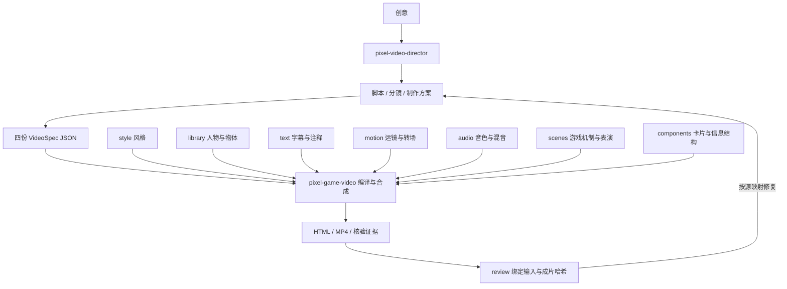

# Codex Skills

像素游戏感视频体系。日常使用两个 skill：导演负责画面设计与制作统筹，基础 skill 负责执行；运镜转场的实现维护在基础制作模块。

| Skill | 职责 |
| --- | --- |
| [pixel-game-video](skills/pixel-game-video/SKILL.md) | 按结构化工程制作视频；默认 Canvas，支持有限原生 Remotion 场景，维护素材、运动、声音与技术证据 |
| [pixel-video-director](skills/pixel-video-director/SKILL.md) | 把文案设计成可见动作、构图光影、运镜与语义转场；可只交付分镜，或继续制作交接、review 和定向修复 |

画面叙事方法已整合进导演技能，包括视觉母题、光影与尺度、镜头和主体运动的区分、前后场景的语义承接。参考片的黑金配色、人物和 RPG 界面按新主题选择；[《深度工作》观片案例](skills/pixel-video-director/references/deep-work-case.md)仅是学习笔记，不代表基础层已实现其中所有效果。

> 使用 $pixel-video-director，先把这段文案演成具体画面，写出主体动作、构图光影、运镜、前后转场和需要准备的素材，只交付视觉分镜。

基础工程只维护四份 JSON，不复制整个引擎。运镜、配色和音效各在自己的模块维护，两个 `SKILL.md` 只保留使用入口和按需链接。纯视觉方案按 [分镜交接与工程映射](skills/pixel-video-director/references/visual-storyboard.md)编写；进入工程后，时间统一由 storyboard.json 维护。

Remotion 接在基础执行层：导演与 VideoSpec 保持原有职责，`renderBackend=remotion` 选择原生 React 场景，由同一份编译时间线驱动。当前试作支持书桌场景、整体相机轨迹和书页遮挡转场，尚未迁移 Canvas 的组件与其他场景。用 [12 秒书桌样例](skills/pixel-video-director/examples/remotion-focus-desk/README.md) 进入 Studio，安装与边界见 [Remotion 说明](skills/pixel-game-video/references/remotion.md)。

## 要求与经验入口

制作、续作或复盘先读 [制作总则与经验入口](skills/pixel-game-video/references/production-principles.md)，再按范围读取下列记录。两个视频 skill 均已接入此入口。

| 记录 | 管什么 |
| --- | --- |
| [仓库维护约定](AGENTS.md) | 文件归属、技能独立与维护验证 |
| [制作总则](skills/pixel-game-video/references/production-principles.md) | 通用制作原则、要求层级与经验沉淀方法 |
| [计算机口播系列偏好](skills/pixel-video-director/references/computing-voiceover.md) | 这个系列的画风、人物职责、背景、叙事与声音方向 |
| 每片的 brief.json / review.json | 本片目标、时长、约束及实际审片证据 |
| [迭代记录](skills/pixel-game-video/references/iteration-history.md) | 历次反馈、有效方法、失败和撤回原因，保留各自适用范围 |

新经验记录现象、结论、范围、状态与证据；更新当前生效的要求，同时保留历史。用户的新要求优先，单片示例不自动升级为通用默认，历史认可不代替本次验证。

## 当前交付基线

| 维度 | 已收纳内容与边界 |
| --- | --- |
| 视觉方法与组件 | 脚本阶段明确解释任务；12类组件覆盖身份、数值、对比、标注、章节、流程、时间轴、清单、层级、条形比较、代码与结论，可按主次组合 |
| 可变背景与片段替换 | 按内容先设计空间与尺度，再复用或制作项目素材；样板只作质感参考，已有房间不构成场所菜单。素材变更参与哈希与导出，默认保留字幕和旁白时序 |
| 风格与人物 | 精致偏暗的像素画面；[已确认 V3 人物库](skills/pixel-game-video/modules/library/CHARACTERS.md)保留无围巾主角、三位差异化像素配角和一位半身专题配角，含人设与30张动作参考；Canvas 通用人物层可按事件切换姿态，Remotion 当前使用静态基准图 |
| 转场 | 12种方法：9种通用配方＋3种空间设计；后三种已在竞赛场景落地，尚非通用recipe |
| 节奏与构图 | 定位→主运动→落稳→阅读；全画幅统一镜头、卡片保持固有比例，按旁白与信息量留停顿 |
| 游戏反馈 | 焦点锁定、触点回弹、资源转移、状态确认、阶段进度、任务结算，共6类 |
| 音效 | 保留已认可的选择、拾取、落位、展开、受阻、奖励6种街机＋鼓点原子；扩展和蓄力实验退出可选库与交付包 |
| 配乐 | Canvas 与 Remotion 共用可选 BGM 混音，支持音量、淡入淡出、截取/循环和旁白压低；内置 Chill Wave 与来源署名，见[配乐工作流](skills/pixel-game-video/modules/audio/MUSIC.md) |
| 交付与核验 | HTML、MP4、结构化工程及独立运行快照；技术核验、用户认可和实际视听review分别记录 |

竞赛视频沿用已获正向反馈的 V6 视觉／V8 音画基线。32秒、筹码数量和试练天数属于该片示例；人物、题材偏好按项目记录，不推广为全部技能的固定条件。本轮停止音效探索，以现有已确认内容准备输出。认可范围及撤回原因集中在 [迭代记录](skills/pixel-game-video/references/iteration-history.md)。

设计转场从 [转场库](skills/pixel-game-video/modules/motion/TRANSITIONS.md) 进入：按交接关系查已实现配方和参考设计，明确实现状态，再安排动作与阅读节奏。

新脚本先按 [视觉表达方法](skills/pixel-video-director/references/visual-system.md) 选择场景或组件，再安排主体变化。[组件体系看图指南](skills/pixel-game-video/modules/components/GUIDE.md) 提供十二类信息结构的实渲染总览、逐类大图、状态对照与组合参考，图片对应的独立示例随基础 skill 分发；[背景基调与样板](skills/pixel-game-video/modules/style/ART-DIRECTION.md) 用于创作新素材；[按镜头替换](skills/pixel-video-director/references/media-replacement.md) 提供可校验的导入入口。导演创作源示例在 [基础五类](skills/pixel-video-director/examples/component-system/brief.json) 与 [新增七类及组合](skills/pixel-video-director/examples/component-expansion/brief.json)。

增强局部游戏感从 [游戏反馈细节库](skills/pixel-game-video/modules/scenes/GAME_FEEL.md) 进入：收纳六类反馈及已获认可的竞赛视频实例，关联触发状态、动作、声音和验收；与转场分开维护。

将 `skills/pixel-game-video/` 完整复制到 Codex 的 skills 目录即可单独使用。使用 director 时同时安装 `skills/pixel-video-director/`；它通过同级目录、显式 `--foundation` 或 `PIXEL_VIDEO_SKILL` 定位基础层。

> 使用 $pixel-video-director，把我的创意转成脚本和分镜，制作一支像素游戏感视频，并给出有证据的 review。

> 使用 $pixel-game-video，在现有工程的第二镜加入碎屏转场，按源文件修改并验证该片段。

运行依赖与命令见 [基础运行说明](skills/pixel-game-video/references/runtime.md)，模块扩展见 [模块维护](skills/pixel-game-video/references/module-development.md)。

仓库仅跟踪 `skills/`、技能索引与维护规则。`legacy/` 历史工程、`docs/` 审片与核验材料、`work/` 制作工程和运行依赖、`outputs/` 成片与交付包均作为本地文件保留，由 `.gitignore` 排除。正式技能所需的图像、PCM 音效母版、示例旁白与测试继续随技能维护。历史提交仍保留原有记录；本地历史媒体不是新引擎的回归结果。新增 skill 或移动目录时遵守 [AGENTS.md](AGENTS.md)。

继续本项目时先读 [计算机知识口播的已确认方向](skills/pixel-video-director/references/computing-voiceover.md)。人物在一侧站立讲述，画面可主导；用物体、状态与场所变化推进观点。获得正向反馈的 [18 秒跨空间叙事工程](skills/pixel-video-director/examples/cs-postgrad-narrative-18s/brief.json)作为实例，认可范围与后续纠偏见 [迭代记录](skills/pixel-game-video/references/iteration-history.md)。

当前工程按实际场景组装预览与绑定运行依赖，导出和安装包共用文件规则；全画幅竞赛场景不再加载旧 spatial / WebGL 实验。独立工程仍包含完整的正式基础运行源码，便于后续修改。
每次交付以当前工程实际核验为准；历史视听反馈与本次技术、文字、播放和听音检查分别记录。
