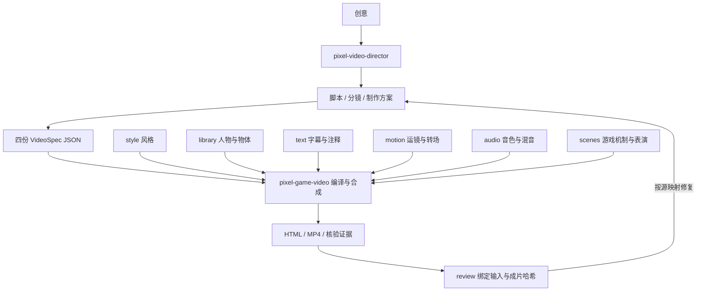

# Codex Skills

像素游戏感视频体系。日常使用两个 skill，运镜转场已融入基础制作模块。

| Skill | 职责 |
| --- | --- |
| [pixel-game-video](skills/pixel-game-video/SKILL.md) | 按结构化工程制作视频；维护风格、素材、文字、运动、声音和场景，构建 HTML、MP4 与技术证据 |
| [pixel-video-director](skills/pixel-video-director/SKILL.md) | 从创意到脚本、分镜、制作交接、review 和定向修复；调用基础 skill |

基础工程只维护四份 JSON，不复制整个引擎。运镜、配色和音效各在自己的模块维护，两个 `SKILL.md` 只保留使用入口和按需链接。

将 `skills/pixel-game-video/` 完整复制到 Codex 的 skills 目录即可单独使用。使用 director 时同时安装 `skills/pixel-video-director/`；它通过同级目录、显式 `--foundation` 或 `PIXEL_VIDEO_SKILL` 定位基础层。

> 使用 $pixel-video-director，把我的创意转成脚本和分镜，制作一支像素游戏感视频，并给出有证据的 review。

> 使用 $pixel-game-video，在现有工程的第二镜加入碎屏转场，按源文件修改并验证该片段。

运行依赖与命令见 [基础运行说明](skills/pixel-game-video/references/runtime.md)。结构、边界和迁移范围见 [架构设计](docs/pixel-video-architecture.md)。实测记录：[重构核验](docs/modular-refactor-verification.md)、[背景与嘴型修复](docs/visual-polish.md)、[强转场与画面构图](docs/transitions-upgrade.md)、[暗色赛博游戏风格](docs/cyberpunk-style.md)。

旧 `pixel-game-explainer`、原始 32 秒成片、8 秒实验及原运动配方完整保留在 [legacy](legacy/README.md)。历史媒体不是新引擎的回归结果。新增 skill 或移动目录时遵守 [AGENTS.md](AGENTS.md)。
