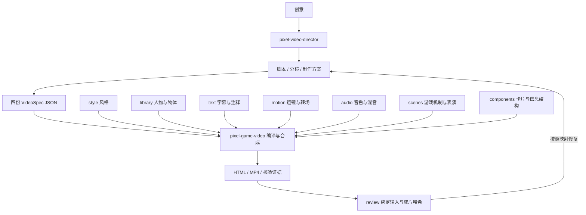

# Codex Skills

像素游戏感视频体系。日常使用两个 skill，运镜转场已融入基础制作模块。

| Skill | 职责 |
| --- | --- |
| [pixel-game-video](skills/pixel-game-video/SKILL.md) | 按结构化工程制作视频；维护风格、素材、文字、运动、声音和场景，构建 HTML、MP4 与技术证据 |
| [pixel-video-director](skills/pixel-video-director/SKILL.md) | 从创意到脚本、分镜、制作交接、review 和定向修复；调用基础 skill |

基础工程只维护四份 JSON，不复制整个引擎。运镜、配色和音效各在自己的模块维护，两个 `SKILL.md` 只保留使用入口和按需链接。

## 本系列要求与经验入口

| 要查什么 | 记录位置 |
| --- | --- |
| 仓库维护边界与文件约定 | [AGENTS.md](AGENTS.md) |
| 本系列当前有效的画风、人物、表演、场景与制作要求 | [上层要求与经验](skills/pixel-video-director/references/computing-voiceover.md)；新片和修改任务从这里带入 brief |
| 人物动态、情境插画的参考拆解与镜头写法 | [人物动态与情境插画](skills/pixel-video-director/references/character-illustration.md)；[基础层看图与运行指南](skills/pixel-game-video/modules/scenes/character-illustration.md) |
| 历史用户反馈、认可范围与撤回原因 | [迭代记录](skills/pixel-game-video/references/iteration-history.md) |

反馈按日期、原话、适用范围、采用规则、相关模块与实现/验收状态积累。项目要求与模块能力分别维护，历史实现限制不替代当前用户要求；本系列偏好也不推广为其他独立 skill 的默认值。

## 当前交付基线

| 维度 | 已收纳内容与边界 |
| --- | --- |
| 视觉方法与组件 | 脚本阶段明确解释任务；12类组件覆盖身份、数值、对比、标注、章节、流程、时间轴、清单、层级、条形比较、代码与结论，可按主次组合 |
| 可变背景与片段替换 | 风格基调＋样板；项目图片/视频按镜头选择，素材变更参与哈希与导出，默认保留字幕和旁白时序 |
| 风格与人物 | [已确认 V3 人物库](skills/pixel-game-video/modules/library/CHARACTERS.md)保留五人、人设和30张动作参考；采用完整人物/场景制作新姿态。旧拆头试样已被否定并撤回，新完整插画仍待用户反馈 |
| 转场 | 12种方法：9种通用配方＋3种空间设计；后三种已在竞赛场景落地，尚非通用recipe |
| 节奏与构图 | 定位→主运动→落稳→阅读；全画幅统一镜头、卡片保持固有比例，按旁白与信息量留停顿 |
| 游戏反馈 | 焦点锁定、触点回弹、资源转移、状态确认、阶段进度、任务结算，共6类 |
| 音效 | 保留已认可的选择、拾取、落位、展开、受阻、奖励6种街机＋鼓点原子；扩展和蓄力实验退出可选库与交付包 |
| 交付与核验 | HTML、MP4、结构化工程及独立运行快照；技术核验、用户认可和实际视听review分别记录 |

竞赛视频沿用已获正向反馈的 V6 视觉／V8 音画基线。32秒、筹码数量和试练天数属于该片示例；人物、题材偏好按项目记录，不推广为全部技能的固定条件。本轮停止音效探索，以现有已确认内容准备输出。认可范围及撤回原因集中在 [迭代记录](skills/pixel-game-video/references/iteration-history.md)。

设计转场从 [转场库](skills/pixel-game-video/modules/motion/TRANSITIONS.md) 进入：按交接关系查已实现配方和参考设计，明确实现状态，再安排动作与阅读节奏。

新脚本先按 [视觉表达方法](skills/pixel-video-director/references/visual-system.md) 选择场景或组件，再安排主体变化。[组件体系看图指南](skills/pixel-game-video/modules/components/GUIDE.md) 提供十二类信息结构的实渲染总览、逐类大图、状态对照与组合参考，图片对应的独立示例随基础 skill 分发；[背景基调与样板](skills/pixel-game-video/modules/style/ART-DIRECTION.md) 用于创作新素材；[按镜头替换](skills/pixel-video-director/references/media-replacement.md) 提供可校验的导入入口。导演创作源示例在 [基础五类](skills/pixel-video-director/examples/component-system/brief.json) 与 [新增七类及组合](skills/pixel-video-director/examples/component-expansion/brief.json)。

[完整插画进入视频](skills/pixel-game-video/modules/scenes/whole-illustration.md) 保留完整场景状态对照与8.4秒独立样例。导演层维护镜头事件、插画原图与提示词，编排脚本生成片段、同步脚本生成基础层快照并记录哈希；基础层按既有 replacement 合同运行，核心入口只路由。旧拆头拼身试样撤回，不继续作为推荐案例。

增强局部游戏感从 [游戏反馈细节库](skills/pixel-game-video/modules/scenes/GAME_FEEL.md) 进入：收纳六类反馈及已获认可的竞赛视频实例，关联触发状态、动作、声音和验收；与转场分开维护。

将 `skills/pixel-game-video/` 完整复制到 Codex 的 skills 目录即可单独使用。使用 director 时同时安装 `skills/pixel-video-director/`；它通过同级目录、显式 `--foundation` 或 `PIXEL_VIDEO_SKILL` 定位基础层。

> 使用 $pixel-video-director，把我的创意转成脚本和分镜，制作一支像素游戏感视频，并给出有证据的 review。

> 使用 $pixel-game-video，在现有工程的第二镜加入碎屏转场，按源文件修改并验证该片段。

运行依赖与命令见 [基础运行说明](skills/pixel-game-video/references/runtime.md)，模块扩展见 [模块维护](skills/pixel-game-video/references/module-development.md)。

仓库仅跟踪 `skills/`、技能索引与维护规则。`legacy/` 历史工程、`docs/` 审片与核验材料、`work/` 制作工程和运行依赖、`outputs/` 成片与交付包均作为本地文件保留，由 `.gitignore` 排除。正式技能所需的图像、PCM 音效母版、示例旁白与测试继续随技能维护。历史提交仍保留原有记录；本地历史媒体不是新引擎的回归结果。新增 skill 或移动目录时遵守 [AGENTS.md](AGENTS.md)。

继续本项目时先读 [计算机知识口播的已确认方向](skills/pixel-video-director/references/computing-voiceover.md)。人物在一侧站立讲述，画面可主导；用物体、状态与场所变化推进观点。获得正向反馈的 [18 秒跨空间叙事工程](skills/pixel-video-director/examples/cs-postgrad-narrative-18s/brief.json)作为实例，认可范围与后续纠偏见 [迭代记录](skills/pixel-game-video/references/iteration-history.md)。

当前工程按实际场景组装预览与绑定运行依赖，导出和安装包共用文件规则；全画幅竞赛场景不再加载旧 spatial / WebGL 实验。独立工程仍包含完整的正式基础运行源码，便于后续修改。
每次交付以当前工程实际核验为准；历史视听反馈与本次技术、文字、播放和听音检查分别记录。
