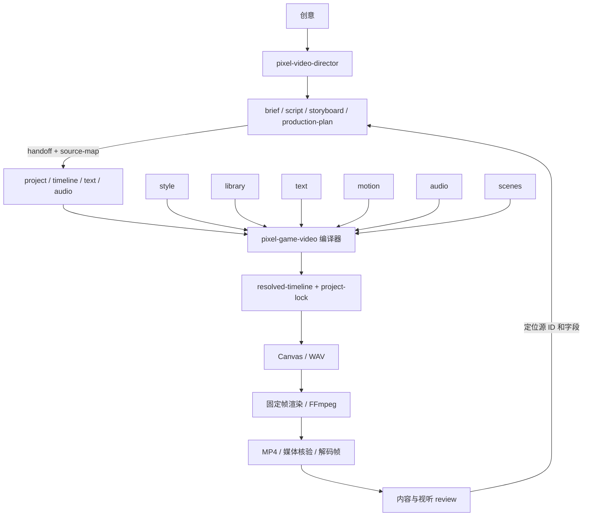

# 像素游戏感视频体系 v1

本次实现采用两个 skill、六个基础模块、四份制作输入。`pixel-motion-transitions` 的选型规则和执行能力融入基础层，不再作为独立活动 skill。实测结果与限制单独记录在 [重构核验](modular-refactor-verification.md)。

## 模块边界

| 模块 | 唯一拥有的内容 | 不在本模块维护 |
| --- | --- | --- |
| style | 色板、字体栈、字号与安全区 token | 题材、脚本、镜头时长 |
| library | 02 角色、表情图、物体资源和来源记录 | 人物出现时间和动作 |
| text | 高清字幕、注释、标题、标签排版 | 脚本文案和嘴型算法 |
| motion | 相机推进、物体揭示、碎屏、金光 | 音效、计数逻辑 |
| audio | G2 音色、变体、声像与混音 | 镜头时长和嘴型 |
| scenes | 步骤、计数、选择、组装、聚焦；嘴型与眨眼 | 人物造型和公共运镜算法 |

每个模块以 `catalog.json`、实现代码、必要素材和短 `GUIDE.md` 维护；不是拆出六份长 prompt。公共编译器只做数据校验、资源引用、帧解析和版本绑定。基础 `SKILL.md` 是路由，创作 `SKILL.md` 是阶段入口。

## 唯一数据源

| 创作层文件 | 拥有内容 | 生成到基础层 |
| --- | --- | --- |
| brief.json | 目标、受众、片长范围与声音模式 | project.json |
| script.json | 字幕、拼音短句、画面标签 | text.json、场景标签 |
| storyboard.json | 镜头时长、语义事件、场景与文字绑定 | timeline.json、文字事件引用 |
| production-plan.json | 风格、人物/物体、运动、声音选择 | project/timeline/audio |

director 的 handoff 生成 `video/` 四份输入与 `source-map.json`；映射包含稳定源 ID、字段、源文件哈希和生成物哈希。上游变化需重新 handoff；手改生成物会报错并指回拥有者。

基础层也能独立使用：`authoringMode=direct` 时直接编辑四份输入。导出为独立快照时携带运行源码与素材，director 源另存供追溯，不制造两个可同时编辑的“真相”。

## 时间与空间合同

- 整数帧是唯一时间单位，区间为 `[start,end)`。各镜头隐式拥有 enter/exit，其他事件只定义一次。
- 字幕、模拟嘴型、声音和运动引用 `shotId.eventId + offsetFrames`。改镜头长度后，后续事件一起重算。
- 场景参数引用镜内事件 ID；场景必须检验引用和事件顺序。
- 坐标统一 0..1，像素世界用 320×180 网格；高清文字按 1920×1080 输出。首版规格不等于任意尺寸已支持。
- `resolved-timeline.json` 供画面和音频共用；`project-lock.json` 与渲染记录绑定源、运行代码及素材哈希。

## 运镜配方合并

| 原文档配方 | 当前维护位置 | v1 表现 |
| --- | --- | --- |
| 碎屏揭示 | motion | 前镜最后一帧碎片揭示后镜；需非首镜 |
| 固定场景、计数积累 | scenes.counter | 事件区间控制进度，终值钳制 |
| 金光突破 | motion.gold-burst | 在指定区间与归一化锚点生成像素粒子 |
| 书封旋转放大 | motion.object-reveal + library.book | 二维正面缩窄再展开，文字不镜像；不是三维书模型 |
| 互动卡收尾 | scenes.choice / scenes 参考 | 已实现选项、选择事件和选中态；原互动人物卡的完整配方仍待实现 |

每种 motion 不自动附带声音；audio 显式绑定同一事件。相机作用于场景图层，字幕覆盖层保持可读。

## Review 与修复

渲染输出技术结果和解码证据；director review 绑定 `inputHash` 与实际 MP4 SHA-256。每条问题记录镜头、时间区间、证据、预期、负责模块和上游字段。

技术通过、视觉通过、听觉通过分开记录。缺少实际检查时为 `not_reviewed`，不能由媒体元数据自动升为通过。修复应回到上游，然后重新 handoff、预览受影响片段、完整出片与复核。impact 提供受影响范围，不宣称已经实现帧缓存复用。

## 迁移与范围

- 原有两个 skill 原样移入 legacy，保留 32 秒基线、8 秒实验和全部参考材料。
- 02 人物像素素材、表情处理和 G2 声音算法复用；通用场景、时间线、渲染接口重新组织。
- 新 direct 例子与 director 例子用于验证模块组合，不成为默认创意、永久片长或用户偏好。
- 原 32 秒/8 秒作品的题材专属场景尚未全部改写为新合同；旧成片与历史核验不冒充新输出。
- 当前是纯音效和模拟讲述嘴型；TTS、真实音素对齐、更多角色/风格和任意创意零代码出片不在此版已实现范围。
- 主后端是浏览器 Canvas 固定时间帧 + FFmpeg。多平台能力必须分别实测，不把当前 Windows 环境成功写成通用适配完成。
