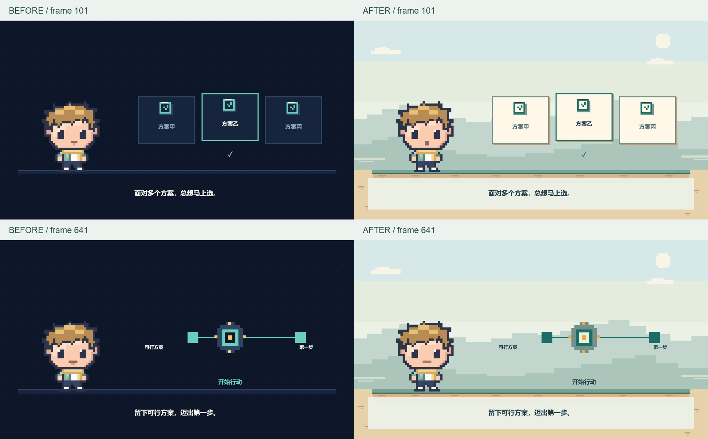

# 背景与嘴型修复 · 2026-10-17

输入为提交 `291b42f` 的 12 秒《先给选择设边界》示例。旧成片保留在 `work/director-acceptance/video/outputs/film-v2.mp4`，新工程从干净目录 `work/visual-polish/` 初始化；四份制作输入和源 WAV 的字节哈希均与旧版一致。

## 复现与修复

| 问题 | 实际原因 | 修改 |
| --- | --- | --- |
| 背景过深且单调 | 藏蓝底、近似底色的点阵和水平线，缺少空间层次 | style 改浅青天空、远近山体、暖沙地台，奶油信息卡配深青文字 |
| 开口像吐舌 | 深色嘴缝下单独挂粉色像素 | library 仅在原 6×2 嘴部区域绘制连续小口腔，脸颊/下巴/身体逐像素保留 |
| 说话僵硬 | 整个音节一直撑着同一个嘴型 | scenes 分为短开口、收口和柔和闭唇，峰值最长约 0.12 秒 |
| 修复初版逐字闪白牙 | 每个音节结束都回原始白色微笑 | 音节内用柔和唇线，短句停顿和字幕外才恢复原图微笑 |

开场眨眼延后，首帧保持睁眼；组装结果文字使用深色 ink，保持亮背景上的可读性。原人物 PNG、角色大小位置、脚本文案、镜头与声音事件均未改动。

## 本次验证

- 基础层 20 项、director 11 项测试通过；新增 4 项检查嘴型改动区域、粉色悬挂、短峰值与短句停顿归位。
- 浏览器实画 choice、steps、counter、assembly 及嘴部连续帧，无页面错误；完整成片 1920×1080、60 fps、12 秒、720 个解码帧，帧时间戳和 AAC 音轨检查通过。
- 实际解码帧对照了选择态、完成态、计数、组装结果和碎屏中段；口型对照使用同一段 0.4–2.8 秒成片裁剪出的 29 帧，不以静态素材图冒充动态验证。
- 检查范围为解码静帧与连续采样帧；不将这些记录写成完整实时播放或主观听音通过。当前仍是无真实人声的模拟讲述嘴型。

[背景前后对照](verification/visual-polish-before-after.jpg) · [口型动态对照](verification/visual-polish-mouth.gif) · [技术核验摘要](visual-polish-verification.json)



## 复现命令

按基础 skill 的 runtime 说明配置 Python、Node、浏览器和 FFmpeg 后，在仓库根目录运行：

```text
python skills/pixel-video-director/scripts/director.py init work/visual-polish --example
python skills/pixel-video-director/scripts/director.py handoff work/visual-polish
python skills/pixel-game-video/scripts/video.py render work/visual-polish/video
python skills/pixel-game-video/scripts/video.py inspect work/visual-polish/video
python -m unittest discover -s skills/pixel-game-video/tests -v
python -m unittest discover -s skills/pixel-video-director/tests -v
```

新 MP4 位于本地忽略目录 `work/visual-polish/video/outputs/film.mp4`。本次不扩大平台或尺寸支持范围。
