# 像素信息组件

组件负责信息结构与局部状态，可叠在任意已支持镜头上；不拥有镜头时长、背景或人物。用 `python scripts/video.py catalog components` 查十二个已实现家族。样式取当前 style 的语义色与字体，`style.pixel-editorial.v1` 提供深底、暖金边角与清晰层级的可选主题，不改变其他主题。

## 先看效果，再选组件

下图和本页各组件大图均由**当前引擎实际渲染**。每类图下说明适用关系和使用边界；点击图片可查看原尺寸。文档统一使用中性背景便于对照，正式视频仍按镜头选择场所、人物与背景。

[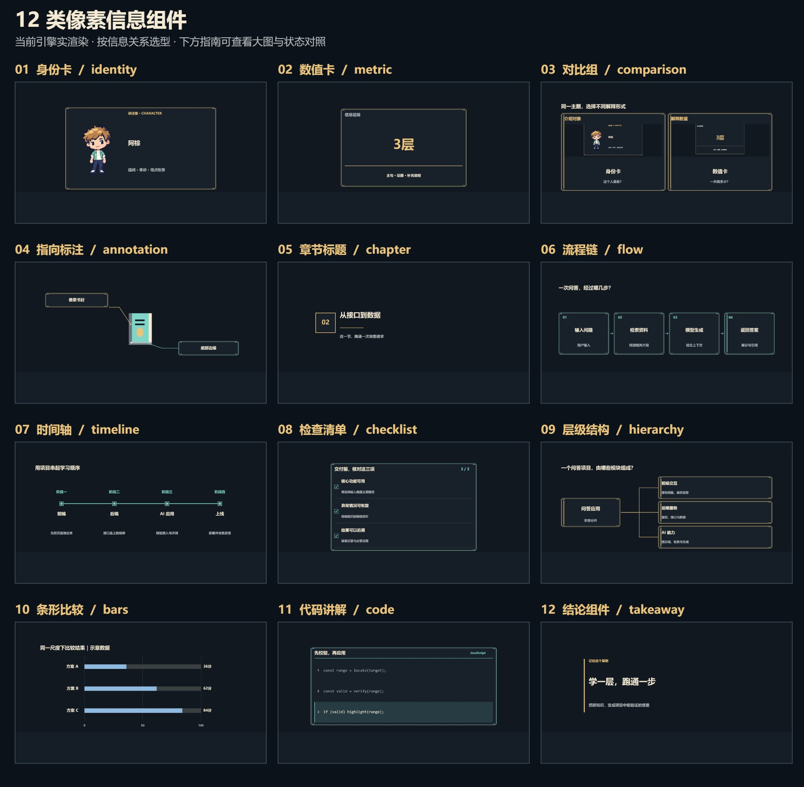](assets/reference/overview.jpg)

| 要解释什么 | 优先选择 |
| --- | --- |
| 谁、什么对象、有什么特征 | [身份卡](#identity) |
| 多少、变化了多少 | [数值卡](#metric) |
| 两三种方案有什么区别 | [对比组](#comparison) |
| 这段文字对应哪个实物或位置 | [指向标注](#annotation) |
| 接下来讲哪一节 | [章节标题](#chapter) |
| 先做什么、下一步传给谁 | [流程链](#flow) |
| 经历哪些阶段、顺序如何 | [时间轴](#timeline) |
| 哪些条件已满足、还缺哪项 | [检查清单](#checklist) |
| 一个系统由哪些部分组成 | [层级结构](#hierarchy) |
| 同单位下，哪个数值更大 | [条形比较](#bars) |
| 代码正在讲哪一行 | [代码讲解](#code) |
| 最后应记住什么 | [结论组件](#takeaway) |

### 身份卡 `identity`

<a id="identity"></a>

[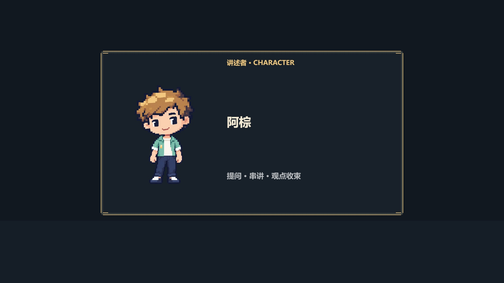](assets/reference/identity.jpg)

用于人物、产品、工具或概念的首次介绍，组织“图像 → 名称 → 简要特征”。可放项目图片，也可承接前镜真实快照；详细过程应另用流程或场景展开。本图人物仅为示例，身份卡不绑定特定角色。

### 数值卡 `metric`

<a id="metric"></a>

[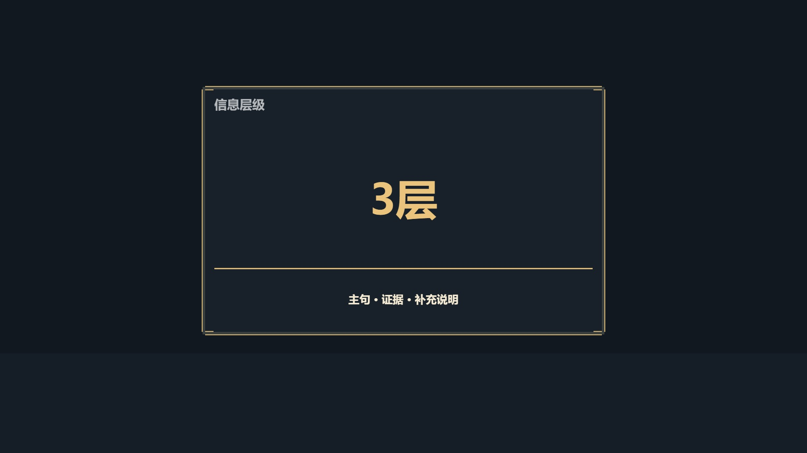](assets/reference/metric.jpg)

用于突出一个关键数量或一段数值变化，保留单位和解释。下图依次是起点、变化中和终值；到达终值后保持，不循环归零。多项数值比较改用条形比较。

[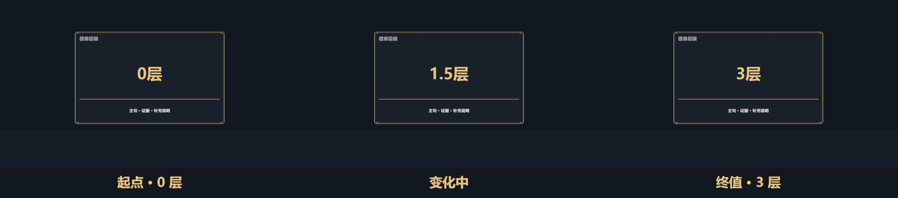](assets/reference/metric-states.jpg)

### 对比组 `comparison`

<a id="comparison"></a>

[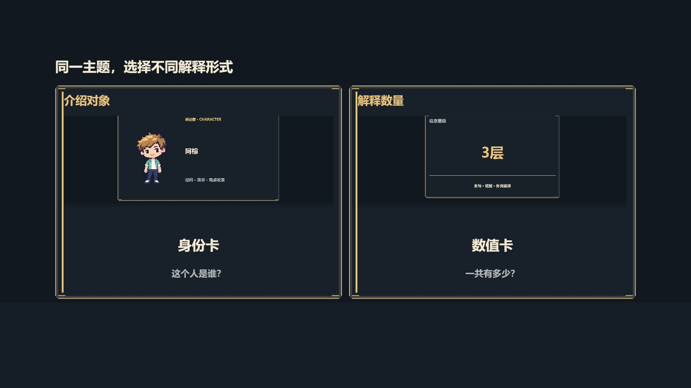](assets/reference/comparison.jpg)

用于两到三项方案、条件或时期的同构对照。示例两列分别嵌入前面的身份卡、数值卡真实快照；列结构保持一致，逐项显露。比较对象应围绕同一问题，避免每列换一套比较标准。

### 指向标注 `annotation`

<a id="annotation"></a>

[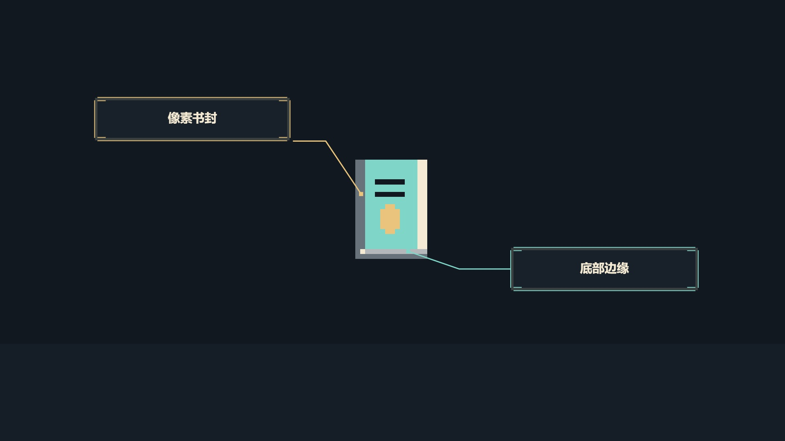](assets/reference/annotation.jpg)

用于指认实物、图像局部或代码位置。短标签靠近对象，引线与端点建立对应关系；引线应避开文字，不能指向没有实际对象的空白位置。

### 章节标题 `chapter`

<a id="chapter"></a>

[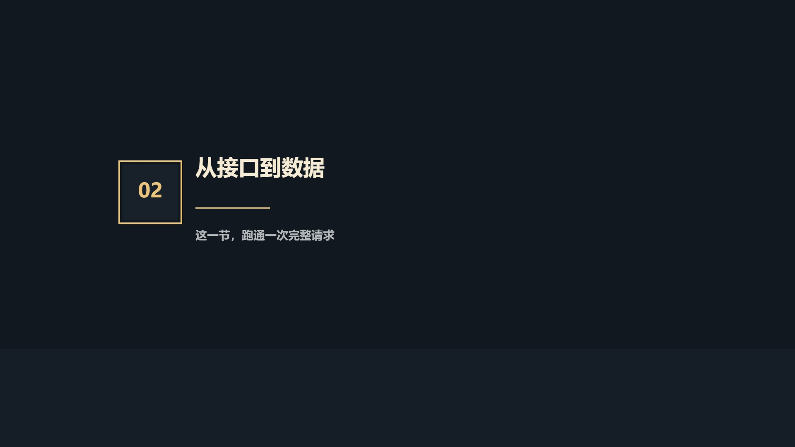](assets/reference/chapter.jpg)

用于段落切换，以编号、主题和一句内容承诺建立观看预期。适合短暂停留后进入讲解，不宜一直占据主要解释区。

### 流程链 `flow`

<a id="flow"></a>

[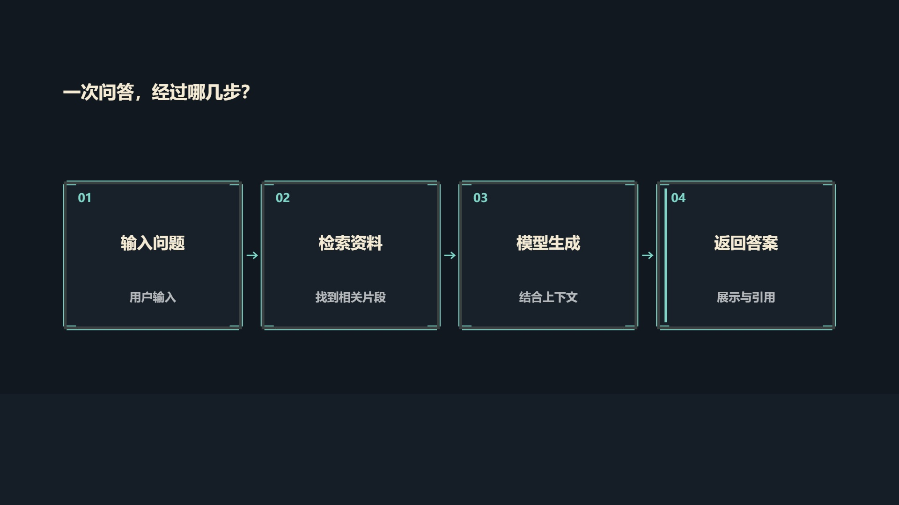](assets/reference/flow.jpg)

用于两到五步操作、处理顺序或传递路径。事件推进当前步骤，已到达节点保持；箭头表示脚本明确写出的传递关系，不单凭先后顺序暗示因果。

[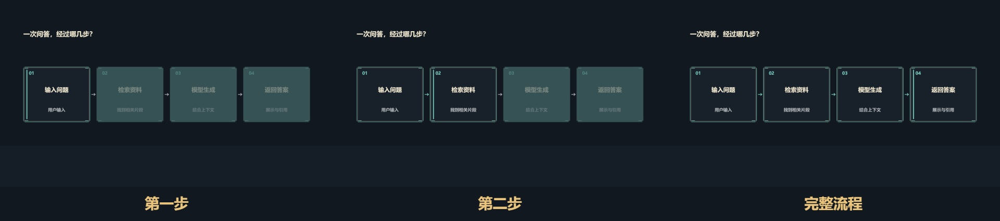](assets/reference/flow-states.jpg)

### 时间轴 `timeline`

<a id="timeline"></a>

[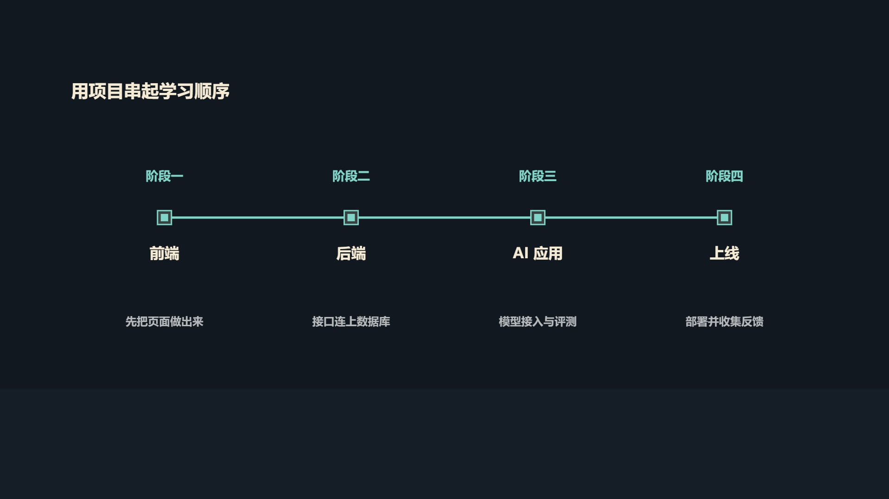](assets/reference/timeline.jpg)

用于三到五个阶段、日期或发展节点。节点等距，只表达次序；上下标签说明阶段及其产物，不能将间距解读为实际持续时长。

### 检查清单 `checklist`

<a id="checklist"></a>

[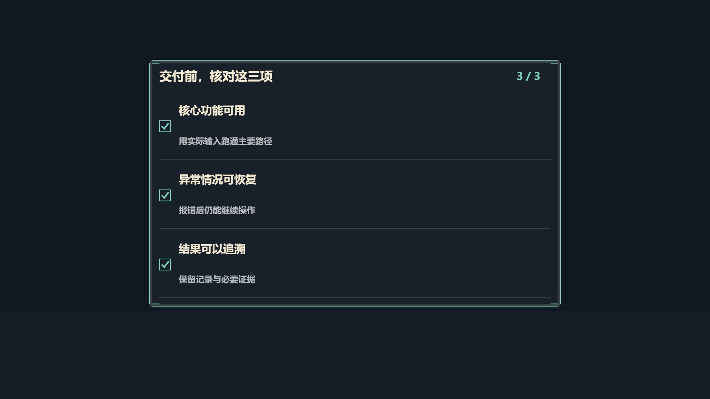](assets/reference/checklist.jpg)

用于两到五项校验条件或完成情况。标签从开始即可阅读，条件满足后累计勾选，并保留完成计数；允许乱序满足。示例是教学状态演示，不是对某个实际工程已完成检查的声明。

[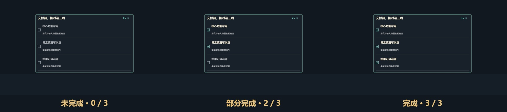](assets/reference/checklist-states.jpg)

### 层级结构 `hierarchy`

<a id="hierarchy"></a>

[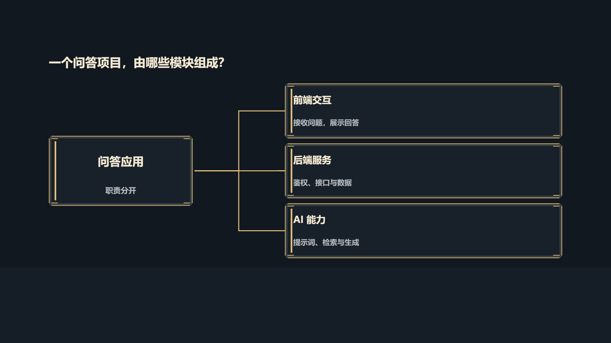](assets/reference/hierarchy.jpg)

用于一个主体与两到四个分支，解释组成、分类和职责。根节点稳定，分支按事件显露；当前只实现一层结构，深树应拆镜讲解。

### 条形比较 `bars`

<a id="bars"></a>

[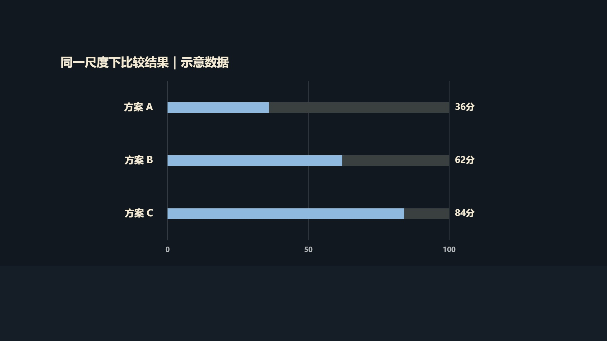](assets/reference/bars.jpg)

用于两到四项同单位数值比较，共同上界、共同零基线。每项依事件增长后保持终值；未知数不能填零。图中 36、62、84 分为结构示意，标题已注明“示意数据”。

### 代码讲解 `code`

<a id="code"></a>

[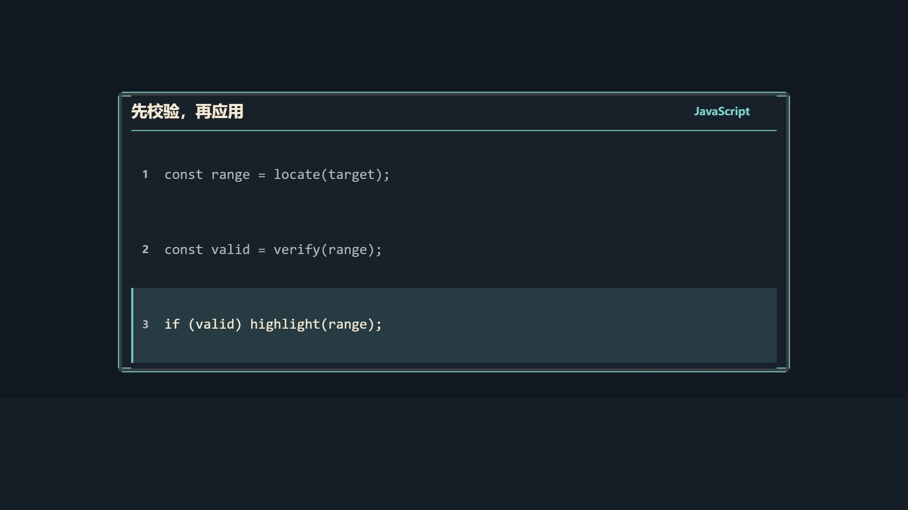](assets/reference/code.jpg)

用于两到七行程序或规则片段，保留原样缩进与行号，依讲解逐行强调。组件不执行代码；长程序应摘取关键片段，不把字号缩到难读。

[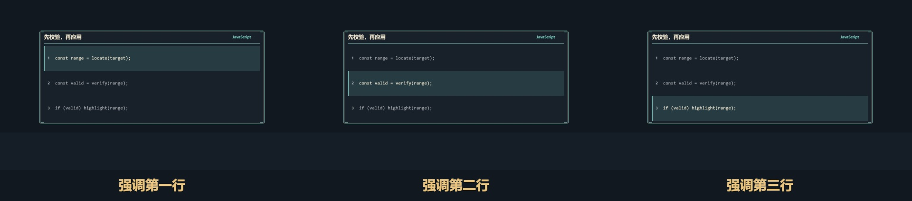](assets/reference/code-states.jpg)

### 结论组件 `takeaway`

<a id="takeaway"></a>

[](assets/reference/takeaway.jpg)

用于原则、结论与记忆点，以开放式主句收束，边缘标记和补充文字保持次级。给背景和主体留空间，避免与同期字幕逐字重复。

## 组合参考

### 流程链 + 检查清单

[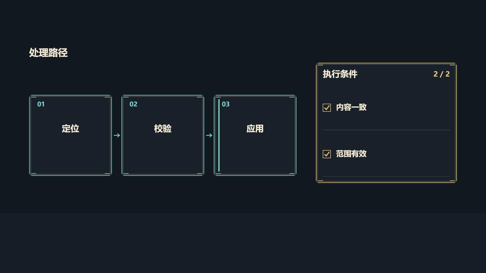](assets/reference/flow-checklist.jpg)

左侧回答“怎么做”，右侧回答“什么条件下可以继续”。主流程占主要空间，清单作为辅助，不抢占同一焦点。

### 代码讲解 + 指向标注

[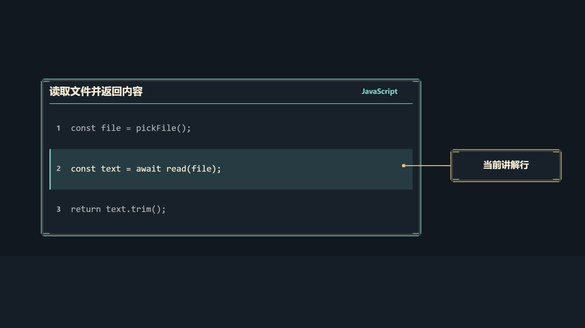](assets/reference/code-annotation.jpg)

代码负责上下文与当前行，标注补充指认；引线落在当前行的空白边缘，避开代码文字。还可按需要组合“条形比较 + 结论”“层级结构 + 身份卡”，先确定主次，再安排显露事件。

## 参数与接入

| kind | data 必填 | data 可选 |
| --- | --- | --- |
| identity | title | eyebrow, detail, image, sourceShot |
| metric | title, from, to, startEvent, endEvent | unit, detail |
| comparison | title, items（2–3项） | 每项 title/event 必填，value/detail/image/sourceShot 可选 |
| annotation | label, targetX, targetY | 无 |
| chapter | index, title | detail |
| flow | title, items（2–5项，每项 title/event） | 每项 detail |
| timeline | title, items（3–5项，每项 label/title/event） | 每项 detail |
| checklist | title, items（2–5项，每项 label/event） | 每项 detail |
| hierarchy | title, rootTitle, items（2–4项，每项 title/event） | 根节点 detail，每项 detail |
| bars | title, max, items（2–4项，每项 label/value/event/endEvent） | unit |
| code | title, items（2–7行，每行 text/event） | language |
| takeaway | title | eyebrow, detail |

公共字段：`id,kind,x,y,width,height,data`；坐标按画幅 0–1。`showEvent` 默认 enter；可用 `focusEvent` 在指定事件后保持强调；`tone` 从 gold/accent/secondary/danger 选择色彩职责。事件使用本镜 local ID，不能引用 exit，数值的 startEvent 必须早于 endEvent。

```json
{"id":"result","kind":"metric","x":0.30,"y":0.24,"width":0.58,"height":0.40,
 "showEvent":"enter","focusEvent":"done","tone":"gold",
 "data":{"title":"已完成","from":0,"to":3,"unit":"项","startEvent":"begin","endEvent":"done","detail":"结果保持到镜头结束"}}
```

在基础 timeline.shots[].components 中使用以上结构。导演工程在 storyboard 同名字段安排布局和事件，title/eyebrow/detail/label/unit/index/rootTitle/language/text 等显示文字全部引用 script.labels；comparison.value 也是文字引用，bars.value 是数值。其余数值与事件直接写入。自由布局可用 `scenes.canvas.v1`，保留 props、人物、项目背景或替换片段，组件绘制在其上，字幕最后叠加。

`image` 是项目 media/ 内的 PNG/JPG/WebP 路径；`sourceShot` 引用更早镜头的最终完整画面（不含独立字幕），二者互斥。快照保留源场景身份，适合回顾与比较。不会递归引用当前或未来镜头。数值变化在终点精确落到 to 并保持，不循环计数。

组件形态不同：身份卡组织图像/名称/特征，数据卡突出数值，对比组维持同构结构并按事件显露，标注连接实际对象，章节用编号与标题组织段落。共用留白、描边、角饰与显露时间。组件文字溢出会报错，应扩展布局或缩短标签，不会自动缩成小字或静默裁切。

## 扩展组件的语义与状态

- flow 的箭头表示明确写出的步骤或传递关系，事件按列表顺序推进；当前节点强调，已到达节点保持。仅有先后关系时，不把箭头解读为因果证明。
- timeline 同样按事件顺序显露，但节点等距，只表达阶段次序；时间标签可写真实日期或阶段名。它不是按实际时长比例绘制的时间图。
- checklist 的标签从开始就可读，事件表示该项已满足，勾选累计并保持；允许条件乱序完成。不要把未检查项伪装成已通过。
- hierarchy 是一层从属结构，根节点稳定，分支按事件显露。表达模块组成、分类或职责；更深层的树拆镜讲解。
- bars 必须给出共同 max，数值在 0..max 内，全部从零基线绘制。每项 event 到 endEvent 完成增长后保持终值；单位一致。未知数不能填零，示意数据要在脚本中标明。
- code 原样显示空格缩进与行号，event 表示当前讲解行，列表事件按顺序排列。每项为单行，使用空格而非 Tab；最多 7 行，单行不自动换行，也不执行代码。较长程序先摘取相关片段。
- takeaway 使用开放式主句和边缘标记，适合原则、总结与记忆点；主句与字幕避免重复逐字占屏。

## 组合方式

单镜先选一个主组件，再按解释需要添加辅助组件。可采用 flow + checklist 表示“处理路径与校验条件”，code + annotation 指认当前代码，bars + takeaway 连接证据与结论，hierarchy + identity 展开某一分支。通过事件错开关注焦点，位置避开字幕和主要对象。不要把十二类全部装进同一镜。

完整新增家族与组合示例见导演 skill 的 `examples/component-expansion/`。每镜的具体文案、场所与时长仍由创作决定。

背景、图像样板与动态素材见 [风格规范](../style/ART-DIRECTION.md)。组件不意味着全屏处处填框；重要对象保留空间，标签与连接线避开其他文字和字幕。使用真实画幅与小屏尺寸查看前、中、后状态。

实现：runtime.js 绘制与状态，contract.py 验证，catalog.json 发现；引擎按实际使用锁定与导出依赖。主题属性归 style，项目文案归 script，帧事件归 storyboard。当前只支持通用组件级显露/强调和上述内部状态；没有开放任意 CSS/HTML 渲染。

## 参考图来源与更新

本页包含十二类组件、两种组合和四组状态对照，均从 [独立参考工程](examples/guide/README.md) 的实际画布捕获。四份 VideoSpec、所需图片和取帧清单随基础 skill 一起保存，不依赖导演 skill、历史工程或本机绝对路径。

在 `pixel-game-video/` 目录执行：

```sh
python scripts/video.py build modules/components/examples/guide
node modules/components/render-reference.cjs
```

运行依赖和环境变量按 [运行说明](../../references/runtime.md) 配置。第一条生成可播放的 `examples/guide/build/film.html`；第二条生成本页引用的 JPEG、大图总览与 [来源清单](assets/reference/manifest.json)。`build/` 是忽略的缓存，正式参考图片保留在 `assets/reference/`。

组件形态或示例源修改后应重新构建、截图并查看中间状态，不能沿用旧图证明新实现。状态对照是取帧参考，不替代动态播放、声音或审美验收；实际字体也受运行环境影响。
