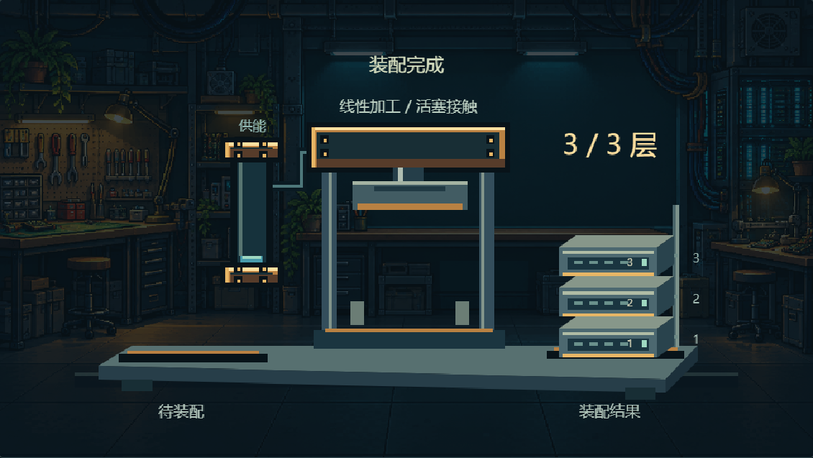

# 物体组件与历史实例

这些是已收纳的独立 Canvas 表现组件，列表见 [object-components.json](object-components.json)。它们与十二类信息组件的 `shot.components.kind` 分开；在项目场景中调用绘制器，或按工程事件合成为项目素材后接入，不填写未注册 kind。背景、字幕、配乐和总片时长仍由项目拥有。

新设计从 [脚本驱动设计](DESIGN.md) 开始，新的独立组件按 [实现协议](CUSTOM-RUNTIME.md) 分离状态、绘制和播放器。旧实例保留原接口与适用范围。

## 内容驱动设计的认可范例：加工站与等待缓冲架

`object.request-queue-study.v1`：[播放与独立样式](examples/request-queue/index.html) · [认可及适用范围](examples/request-queue/design.md)。2026-11-01 用户认可本次两片段脚本到组件的效果：先建立逐件处理，再保持处理周期并让到达变密，等待因此可见。固定视角、两套有限输入的独立 HTML，未接入工作台。机械造型只属于此例，不成为所有项目默认。

## 状态变化完整范例：复合仪表与条块散落

`object.state-meter-break.v1`：[播放](examples/state-meter/index.html) · [设计与调用](examples/state-meter/design.md)。由脚本需要推导出数值/分段条联动和原条块脱离；组件状态与绘制独立于播放器，支持事件绑定、稳定 ID、非顺序取帧、数量和布局变化。纯 Canvas 独立试样，未注册 shot.components.kind 或工作台适配器；不宣称任意物体碎裂。

## 当前五维动作范例：筹码入托盘

`object.resource-bundle-into-tray.v1`：[播放与五维约定](examples/resource-into-tray/index.html)。同一组筹码短弧线转移，容器内部平面定位落点，真实前壁与近侧壁轮廓负责遮挡。主运动 20 帧、收尾 6 帧，60fps；不是所有组件的固定秒数。支持原固定视角与两种位置／尺寸布局，不宣称任意容器或逐枚搬运可用。

本例不受基础组件三样式的外形限制；换角度、容器和动作机制按[五维](DESIGN.md)补素材并核验。[完整集合](examples/style-atlas/README.md)同时收纳基础组件和以下历史实例。

## 面试牌桌：三个独立组件试样

[统一播放与五维约定](examples/interview-components/index.html)：切换牌组、印章或试做台，可播放、拖动进度并切换宿主位置和尺寸；五维约定在页面中展开查看。三项均为 `prototype-standalone-canvas`，尚未获得用户审美认可，尚未接入工作台。Node 状态与语法检查已执行；浏览器视觉与操作核验由本次实际证据另行记录，不凭代码检查声明通过。

| 组件 | 对应当前分镜 | 动作与结果 | 绘制入口 |
| --- | --- | --- | --- |
| `object.interview-cards.v1` 实体对照牌组 | 第 02–08、12 镜 | 同一副三张 A/B 对照牌依次翻开，校园牌被拿起后归位；牌背、正面和对象身份连续 | [interview/cards.js](interview/cards.js)，`PixelInterviewCards` |
| `object.judgment-stamp.v1` 悬停判决印章 | 第 09、13 镜 | 一枚印章接近简历、留隙悬停，再移开并放到桌边；简历始终未盖印 | [interview/stamp.js](interview/stamp.js)，`PixelJudgmentStamp` |
| `object.task-workbench.v1` 任务试做台 | 第 11 镜 | 同一报名任务暴露必填校验缺口，补规则后重试；空提交被拦住，有效报名被保留 | [interview/task-station.js](interview/task-station.js)，`PixelTaskWorkbench` |

浏览器中先加载 [interview/drawing.js](interview/drawing.js)，再加载所选绘制器。三者均提供 `draw(ctx, {time, x, y, width, height})` 与 `stateAt(time)`；Node 可直接 `require` 对应绘制器，由它加载共享依赖。宿主拥有背景、字幕、音频及镜头时间，组件不清空画布、不自播、不循环，并在宿主矩形内保持原比例。例如：

```javascript
// 已依次加载 interview/drawing.js 和 interview/cards.js。
// time 由当前镜头事件换算，本例仅演示一个组件调用。
PixelInterviewCards.draw(ctx, {time, x: 0, y: 0, width: 960, height: 540});
```

试做台另提供纯函数 `submit({validationInstalled, name, records})`，统一播放页可实际检查空值拦截与有效提交；表单为本地模拟，不连接真实报名服务。以上支持范围为当前固定视角、对象与动作，以及原布局和等比缩小后贴右下边缘的布局；持牌与握章的手臂依赖画幅边缘出画，不能把裁切后的手臂悬空放在桌面中间。换牌型、视角、手部动作或任务逻辑时核验变化部分。三项均未注册为 `shot.components.kind`，正式接入仍按场景调用或项目素材流程完成，并另外核验工作台编辑与导出。

## 完整人物接取道具试样

`object.character-offer-receive.v1`：[播放接信动作](examples/offer-receive/index.html) · [五维与调用](character/README.md) · [绘制器](character/offer-receive.js)。使用 8 张完整人物姿态完成伸手、握住信封、收回胸前与持稳，不拆头像和身体。宿主可控制时间、位置与等比尺寸；目前限定阿墨、正面视角与信封，其他人物和道具需补齐动作素材。静帧造型和独立动作已获认可，并作为预合成素材用于第一镜；尚未注册为工作台原生组件，不填写为 `shot.components.kind`。新组合仍需单独审看。

## 历史认可实例：供能、活塞加工与结构装配

`object.energy-actuator-assembly.v1`，用户于 2026-10-29 认可并要求收纳。2026-10-30 起，基础风格改为机械／能量互斥；此旧融合装置保留源码与历史五维参考，新制作须按当前单一风格重新审看，不自动沿用旧混合外观。

- **表达**：同一批资源经过供能和加工，逐块移交，形成保留的装配结果。适合解释处理过程、逐件产出及积累；物理装置是讲解隐喻。
- **形态**：冷色机架、暖色接缝、青色储能管；机械动作使用线性活塞与夹具，不以齿轮装饰建立风格。
- **动作**：三轮送入、加工、送出、落位；每轮分别为 0.30 / 0.20 / 0.30 / 0.10 秒，轮间留停顿，4.5 秒试样末态保持。数值属于此组件，不推广为全部组件默认值。
- **素材与身份**：代码绘制，无外部物体贴图；三块模块各绘制一次。来源、加工/移交、装配三种归属互斥；背景独立。
- **能力**：已验证固定视角、三个模块与原比例的 Canvas 绘制。换视角、模块数、装配路径或材质需扩展实现并重审；不宣称工作台或成片已验收。

[播放独立样例](examples/energy-actuator-assembly/index.html) · [绘制实现](fusion-component.js)



```javascript
// 先加载 fusion-component.js。time 为本组件开始后的秒数，由项目事件换算。
PixelEnergyAssembly.draw(ctx, {time, x: 0, y: 0, width: 960, height: 540});
```

绘制器不清空画布、不自播、不循环、不绘制背景；保持 16:9 的绘制区域，并按当前镜头与背景检查相对尺度。`stateAt(time)` 返回三个模块的归属，`itemPos(item)` 返回局部 480×270 坐标。纯效果预览沿用当前固定页面，切换内容或方案，不为每轮反馈创建新入口。
