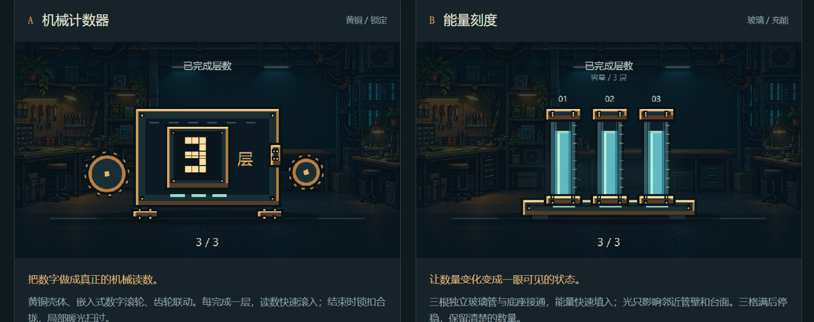
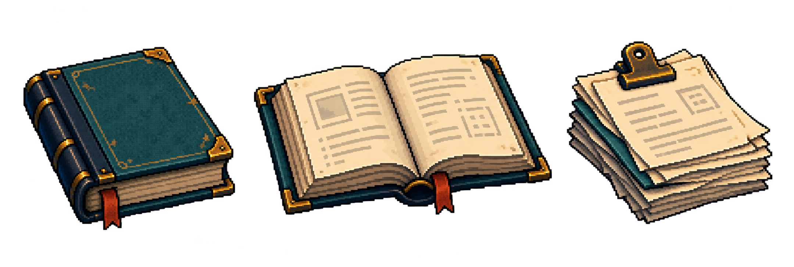
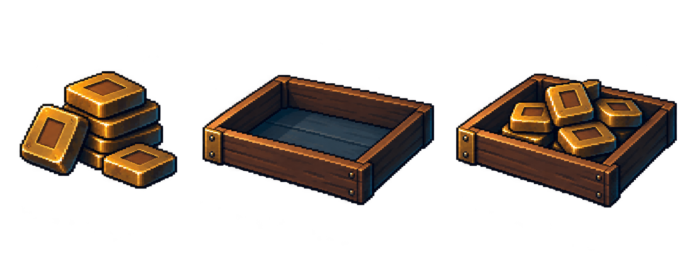
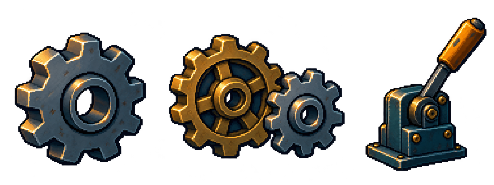

# 组件画风与动作案例

按需查看参考，不将案例外形作为组件白名单。通用创作方法见[组件五维](DESIGN.md)，当前引擎信息组件效果见[目录](INFORMATION-COMPONENTS.md)。用户反馈记录统一见[迭代历史](../../references/iteration-history.md)。

## 已确认的物体组件美术参考

### 当前齿轮造型：统一使用黄铜金色原图

用户在指定三枚原图后进一步选择统一使用[黄铜金色齿轮](assets/gears/brass.png)，不要灰色。所有可见齿轮直接调用此 PNG 的透明轮面和镂空，不随大小或旋转方向改选灰色钢轮。钢轮与钢铜组合轮仅保留为历史素材，不参与当前绘制。资源边界与哈希见[素材清单](assets/gears/manifest.json)。下方计数器旧记录继续指导材质、边框和能量管，不再决定当前齿轮造型。

### 计数器与能量管：当前明确基准

2026-10-30，用户找回并确认下图：机械采用实心深色轮面、黄铜轮缘与亮轴心，壳体边框有明暗层次；能量采用青绿玻璃、黄铜端帽与层次底座。两种风格共享黄铜点缀，靠传动／充流机制区分，不做纯蓝能量外壳。厚度与额外分层仍由堆叠特性控制；详见[基础规范](BASIC-COMPONENTS.md)。

### 更早的独立物体素材方向

用户已认可下列静态美术方向：结合工坊背景的硬边像素轮廓、冷色阴影、暖色受光与简化材质。新组件结合实际背景选择形态、光影与配色。

这些是 image_gen 参考图，尚非清稿的通用精灵表。裁取、透明边缘和锚点按使用检查；画风认可不代表书本翻页或齿轮咬合已实现。

## 已认可的最小动作样例

供能、活塞加工与结构装配融合效果曾获认可，保留于[物体历史实例](OBJECT-COMPONENTS.md)。2026-10-30 起，新制作改为机械／能量风格互斥、堆叠作为特性；旧融合外观不作为当前默认。静态素材仍可参考其像素语言，不能覆盖当前风格约定。

[播放筹码入托盘](examples/resource-into-tray/index.html)：同一组筹码沿短弧线进入托盘，真实近侧壁轮廓负责遮挡，落稳后保持。主运动约 0.33 秒、收尾 0.10 秒；可逐帧、显示分层、对照两种位置和尺寸布局。

用户认可此效果和五维方法。验证范围为该素材、固定三分之四视角下的整组转移与遮挡；换容器、换视角或逐枚转移需另行准备。此独立 HTML 试样未注册为通用引擎能力，路径与时长由后续内容决定。
