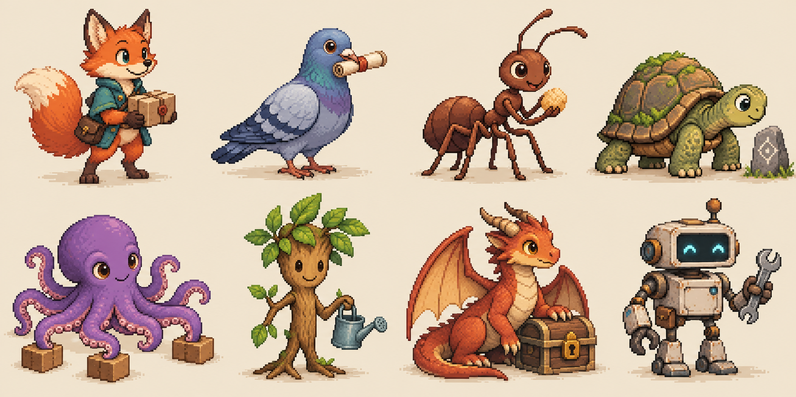

# 角色扩展：物种、身份与风格

2026-11-01 起扩展角色设计：物种用于适合的比喻情境，像素样式按场景选用。已有 V3 五人基准与认可范围保留；本页新增的是开放式设计目录，不是新增运行时 actor，也不自动替换系列主角。可看 [选型画廊](characters/design-atlas/index.html)，风格描述唯一维护在 [像素样式指南](../style/PIXEL-STYLES.md)。

## 四项分别决定

1. 解释关系：本镜要说明什么，隐喻对应的真实对象、行为与边界是什么。
2. 物种与身体形态：人类、动物、植物、幻想生物或人造角色；是否拟人、如何移动和操作物体。
3. 身份：主角本人、主角的明确隐喻化身、新的情境角色或群体；锁定识别特征。
4. 画法：读取项目主画风或片段特选，按 [透传合同](../style/ART-DIRECTION-CONTRACT.md) 取得通用与人物/物种分支要求，统一同镜背景与道具；本分支不能自己选择另一画风，组件独立。

动物不必成为新的常驻人物。小棕与“穿薄荷衣的狐狸”不自动是同一身份；若需主角化身，在脚本明确转换承接、保留哪些识别特征及何时回归。普通口播继续遵守项目的讲述者规则，情境物种不自动接替声音。

## 物种候选与隐喻边界

这是开放目录；表中情境是可选设计，不给物种固定性格，也不把某个角色永远绑定为正确者或失败者。

| 类别／样板顺序 | 可演绎的关系 | 身体与动作设计 | 隐喻需要说明的限制 |
| --- | --- | --- | --- |
| 1 狐狸／犬猫等哺乳类 | 搬运、寻找、路线选择、人与任务的距离 | 保留吻部、耳、尾；自然四足或明确双足拟人二选一，手掌是否能抓握写清 | 狐狸不默认狡猾，犬猫不默认忠诚或懒惰 |
| 2 鸟类 | 全局视野、信息传递、路径与落点 | 翼、爪、喙各司其职；自然鸟用喙或爪取物，拟人翼手需先定造型 | 飞行距离不等于信息零延迟，不能借鸟瞰省略真实限制 |
| 3 蚂蚁等昆虫 | 分工、协作、局部规则、拥塞 | 先定自然六足或明确简化；同角色各姿态保持足数和触点 | 协作不代表没有成本，群体不默认完全同质 |
| 4 龟等爬行类 | 节奏、保护、负载、检查后前进 | 壳与躯干统一，四肢伸出位置固定；明确直立拟人或自然爬行 | 慢不默认低效，壳的保护不代表绝对安全 |
| 5 章鱼等水生类 | 多任务、共享资源、并发协调 | 锁定腕足数、吸附与承托；水下活动或拟人陆地环境明确交代 | 腕足多不代表无限吞吐或真正同时完成所有工作 |
| 6 植物／菌类 | 生长、依赖、反馈、网络扩展 | 自然生长或拟人根脚分开设计，不能无说明随镜改变身体结构 | 生长时间不直接对应技术迭代周期；不冒充生物学事实 |
| 7 幻想生物 | 门槛、守护、储备、未知风险 | 先定角、翼、尾与肢体结构，能力规则必须在情境中成立 | 魔法只承担示意，不能替真实机制补因果 |
| 8 机器人等人造角色 | 指令执行、工具边界、自动化与人机协作 | 关节、夹爪、传感器和能量状态固定；形态服务实际动作 | 是角色类别扩展而非生物物种，不默认拥有自主意识或无限能力 |

样板只演示造型；不是八个已命名角色，也不是一张图证明任意物种×任意风格都已生成。新需求可补鱼、蛇、群落或其他物种，不受表格限制。

## 拟人程度要具体

- 自然体态：动作靠真实身体完成，允许表情简化；不随意加手。适合需要保留结构关系的比喻。
- 拟人体态：可站立、穿衣和使用工具，先统一全身比例、关节及抓握规则；保留物种可识别结构。
- 符号化：以简化轮廓代表群体或状态，适合远景和密集关系；近景表演须补足结构，不能放大后仍靠圆点代替抓握。

## 生成与验收

可复制提示词结构：

> 用途与解释关系：【真实关系→画面隐喻，限制】。角色：【物种、自然／拟人程度、身份、体型、吻／喙／叶／关节等结构、服装或标记】。画法：【样式指南中的完整描述】，与同镜环境、道具统一。处境：【空间、主光、景别】。动作：【初态、触发、整体姿态、接触、结果】。连续性：【固定特征及与相邻镜关系】。字幕和标签独立，不烘焙进图。先生成完整母图，不拆头拼身。

先看整体比例、物种识别、肢体数量、重心和接触，再看同镜颗粒、透视、光源、遮挡及最终占画尺寸。动物的嘴型须按吻部或喙另做，不能直接套人类嘴型；触手、翅膀、尾巴的姿态须实际备图与实现。姿态切换不等于连续动画或口型完成。

项目沿既有 brief.constraints 记物种、身份与画法；script/storyboard 的既有 intent、visual.subject/action 记隐喻与动作，production-plan 记录素材选择，不新增引擎不认识的字段。进入素材库时再按 [素材接入](details.md) 记录尺寸、锚点、来源、哈希与实际能力。样板图不要注册成 actor ID。

本次样板状态见 [来源记录](characters/design-atlas/sources.json)：已生成并做静帧检查，用户已认可物种样板方向；多足、多腕的解剖清稿、透明素材、动作序列及成片仍须单独验收。V3 认可不延伸到这些新候选。
