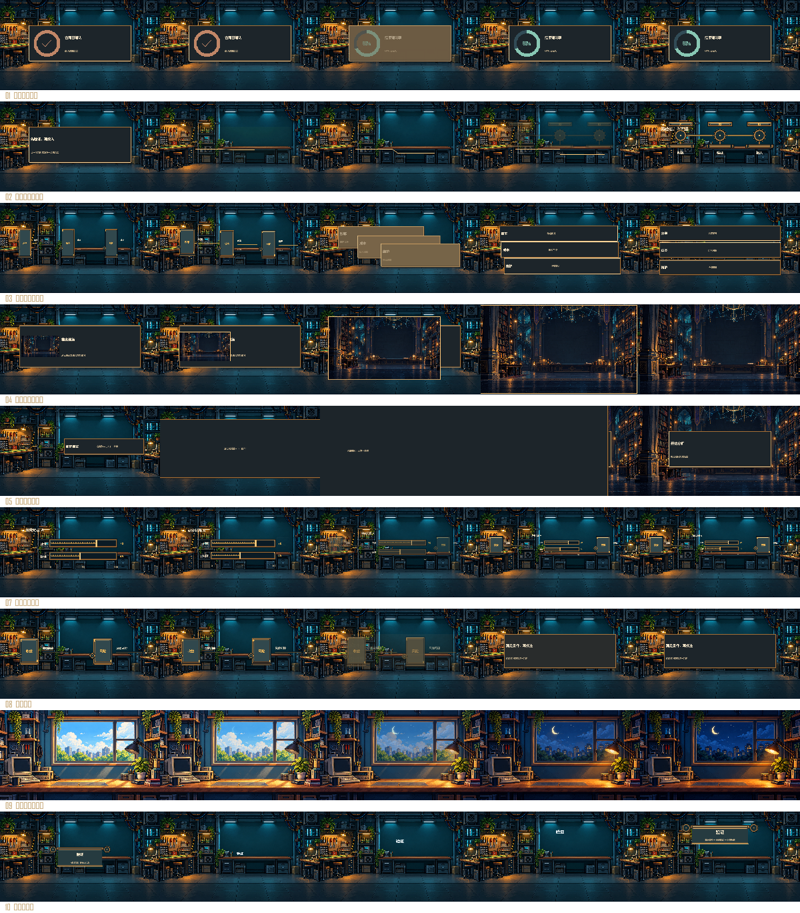

# 内容交接：执行用法

## 选型与替换

九种关系及旧方案的优先替换只在[转场入口](../TRANSITIONS.md#内容交接选型)维护。这里说明四个新配方族；昼夜变化复用cross-dissolve与项目素材。

格式见[catalog.json](../catalog.json)，参数及引用约束以[handoffs.py](../handoffs.py)／编译器为准，执行在[content-handoffs.js](../content-handoffs.js)。不要把设计名称或mode填写成独立recipe。

## 共同前提

- 当前只接入Canvas，两镜不能配置motion.camera-*；当前合同按固定相机工作。转场中重新排版组件与文字，使用项目自己的data、visualStyle与features；不会自动识别印章、生成数据环或判断语义是否相关。
- source／sources、pair.from引用前镜component ID；target、pair.to引用后镜component ID。来源末态和目标落稳时须可见。中间尺寸必须能正常排版，过长文字或过小组件需调整，不回退成截图缩放。
- 组件交接不把独立口播人物收进组件；烘焙在媒体里的小人须先提供干净素材。背景和组件的材质、像素尺度及受光仍按当前项目核对，不绑定某个工坊或配色。
- 工作台使用独立CanvasTransitionUnit，组件JSON和转场参数JSON分别编辑；正式成片仍走工作台流程。

## component-handoff

`motion.component-handoff.v1`的match／overview各一组pair，reflow可多组；overview保持组件比例。

```json
{"mode":"reflow","pairs":[{"from":"record-a","to":"row-a"},{"from":"record-b","to":"row-b"}]}
```

merge把多个依据合成一个判断，不能含混合并互斥选项：

```json
{"mode":"merge","sources":["benefit","risk"],"target":"answer"}
```

keyword的共同词须存在于两侧data.title。rect为文字起点与占位，字号按画高比例；按实际字体和标题位置填写，不能照抄示例坐标。

```json
{"mode":"keyword","pairs":[{"from":"question","to":"heading"}],"word":"验证","fromRect":[0.48,0.45,0.1,0.06],"toRect":[0.47,0.20,0.1,0.06],"fontFrom":0.037,"fontTo":0.046}
```

## line-handoff

`motion.line-handoff.v1`把旧线条接为路线，后镜组件接住其关系。startLine是两点，points是路线点；避开文字，不凭空添加装饰折线。

```json
{"source":"premise","target":"route","startLine":[[0.22,0.53],[0.57,0.53]],"points":[[0.22,0.53],[0.50,0.53],[0.50,0.59],[0.78,0.59]]}
```

## preview-expand

`motion.preview-expand.v1`参数为`{"source":"preview"}`。来源须为identity，其data.image等于后镜background.file，图片与项目画幅同宽高比，后镜dim=0。默认从绘制器读取实际图片视口；显式window也必须匹配该视口。它不是对任意画面的自动推近，视频预览或其他形态需要扩展合同。

## panel-occlusion

`motion.panel-occlusion.v1`参数如`{"source":"file","direction":"left"}`，方向可为left／right。来源须为宽identity面板（实际宽高比大于8:3）：完整底板覆盖画幅，在遮挡中切镜后移出。带透明空隙的竖向装置不能承担此动作。

## 源例与证据

[18镜头源工程](../../../examples/content-handoffs/README.md)提供九种用法；[检查脚本](../../../tests/content-handoffs.cjs)覆盖实际组件重绘、首尾、遮挡中点、随机跳播、口播人物位置及独立转场一致性。结果只证明当次覆盖范围；工作台UI播放、保存重开、逐轨及成片MP4需另行实测。


