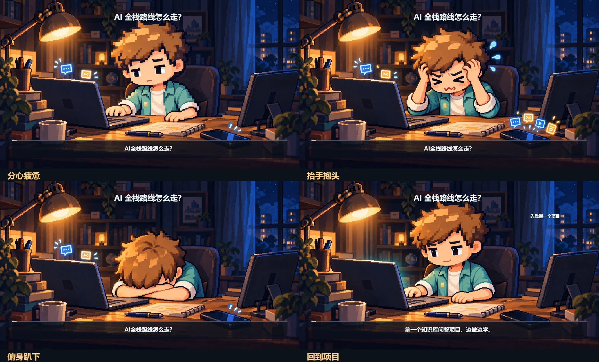

# 完整插画进入视频

**本插图集合仅供参考风格与演绎方法，不是每次必用的素材包或固定结构。** 是否使用、由谁出场及放在哪里由本片脚本决定；不照搬书桌布局、通知剧情、动作顺序、片长或“插画开场再总结”的结构。每个画面都可以没有小人；情境插画按剧情选择主角或配角，并遵守各角色使用范围。

本例用同一书桌场景中的完整人物姿态，表现“分心疲惫 → 抬手抱头 → 俯身趴下 → 收拢注意力”。头、颈、肩、躯干和手臂在每张插画里一起成立，不再分别缩放或旋转拼接。旧拆头试样已经被用户否定，见 [撤回记录](character-illustration.md)。



上图来自实际运行的 [8.4秒独立工程](examples/whole-illustration/)，先播放约5秒完整插画片段，再回到路线总结组件。情节和时长属于本例，不把抱头、趴下变成所有视频的模板。新插画仍待用户审美反馈。

## 从文案到完整画面

1. 选可演绎的处境，写清主体、触发、动作、结果与承接。插画承担解释任务。
2. 用已确认人物基准作为身份参考，先生成完整场景母图。检查头身比例、颈肩连接、手与道具接触、透视、光源和字幕空间。
3. 以母图制作完整姿态的关键帧与过渡帧，保持镜头、场所、服装和设备布局。眨眼也用完整画面的对应帧，不拿头像替换身体。
4. 按镜头事件编排姿态，给触发、反应和结果留时间；后续接什么由脚本决定，不预设必须回到组件讲解。

复用人物身份、像素画风与内容驱动的演绎方法；新片结构、场所与构图按脚本设计。同一组相邻姿态维持空间连续，不代表其他镜头要照搬布局。完整形体的视觉统一优先于身体零件复用。

口播人物按项目约束准备嘴型和停顿反馈；固定身体姿势的项目需使用同一底图的局部开闭嘴，不能轮换这些情境姿态。本组不提供通用口型适配；仅有静态图配旁白、眨眼或整图漂浮时仍记为制作缺口，不能因此取消项目要求的口播职责。

本例是**有限关键姿态动画**：7张完整插画，以事件选择保持帧，含一次完整帧眨眼。没有帧间骨骼、光流形变、逐帧连续表演或音素对齐。更连贯的动作需要补画中间姿态，或使用实际视频生成能力后再核验；编码帧率不能证明动作流畅。

## 接入与运行

使用 `scenes.canvas.v1` 的 replacement 放完整片段，`actor:null` 避免再叠一个人物。字幕、旁白、声音及组件沿用镜头事件。不用 background 引入完整人物场景后再叠角色。

```json
{"id":"s1","actor":null,"objects":[],"motions":[],
 "replacement":{"file":"media/whole-illustration.mp4","kind":"video","fit":"cover"}}
```

从基础 skill 根目录运行，依赖按 [运行说明](../../references/runtime.md) 配置：

```text
python scripts/video.py build modules/scenes/examples/whole-illustration
python scripts/video.py render modules/scenes/examples/whole-illustration --name whole-illustration
node modules/scenes/render-illustration-reference.cjs
```

快照包含编好的无声插画片段、旁白和四份输入，独立运行不回读导演 skill、参考视频或本机缓存。[参考图来源](assets/whole-illustration/manifest.json) 绑定当前构建；连续播放与听音仍须单独审片。

## 维护源与衍生物

导演 skill 的 `examples/whole-illustration/` 是本例唯一创作源，保存四份 JSON、完整插画、生成提示词和 `illustration-plan.json`。计划只把事件映射到图片，时刻和片长只在 storyboard 定义。从导演 skill 根目录执行：

```text
python scripts/render-illustration.py examples/whole-illustration
python scripts/render-illustration.py examples/whole-illustration --check
python scripts/sync-illustration-example.py
python scripts/sync-illustration-example.py --check
```

编码脚本绑定源图、事件、输出规格与脚本哈希，检查会拒绝旧片段，也拒绝覆盖未知或手改输出。同步脚本生成基础层独立快照并记录来源哈希，拒绝覆盖手改快照。单片的新故事和试错留在工程，核心 SKILL.md 只做路由。

审片先看比例与连接，再看动作、状态衔接和文案关系，最后核对编码与声音。人头分离、肢体比例或透视冲突应退回整幅插画；像素变化、脚底稳定或测试通过不能覆盖视觉失败。
