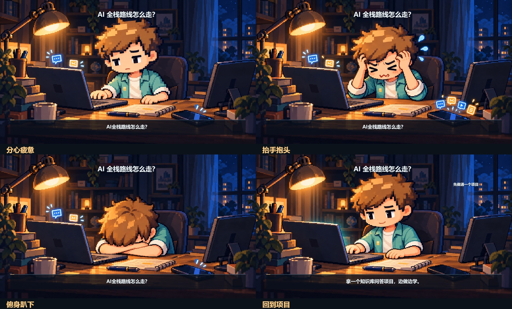

# 完整插画进入视频

**本插图集合仅供参考风格与演绎方法，不是每次必用的素材包或固定结构。** 是否使用、由谁出场及放在哪里由本片脚本决定；不照搬书桌布局、通知剧情、动作顺序、片长或“插画开场再总结”的结构。每个画面都可以没有小人；情境插画按剧情选择主角或配角，并遵守各角色使用范围。

本例用同一书桌场景中的完整人物姿态，表现“分心疲惫 → 抬手抱头 → 俯身趴下 → 收拢注意力”。头、颈、肩、躯干和手臂在每张插画里一起成立，不再分别缩放或旋转拼接。旧拆头试样已经被用户否定，见 [撤回记录](character-illustration.md)。

本页的“完整插画镜头”还指**整幅情境承担整个视频画面**，不只是人物没有被拆开。它与“侧边主持人＋另一侧配图窗口”是两种镜头形态；插图素材可被其他镜头引用为图卡，但那不等于整屏情境。按项目选择呈现方式，本例用整屏 replacement，只有独立字幕、进度等必要覆盖层；不把某个系列的全屏偏好推广为所有图片用途。

先由项目脚本确认选择了插画片段，再执行本页的素材与接入流程；普通代码、组件或操作演示即使铺满画幅、没有主持人或没有旁白，也不能仅凭这些条件改称插画。画面类别与声音分别安排，本页不会替项目决定旁白必须继续或必须停止；无人声不等于无字幕，项目要求的具体讲解仍通过独立字幕覆盖层保留，不能因 replacement 或 sfx-only 而漏掉。人物选择先遵守项目已确认的主角连续性与配角使用条件。



上图来自实际运行的 [8.4秒独立工程](examples/whole-illustration/)，先播放约5秒完整插画片段，再回到路线总结组件。情节和时长属于本例，不把抱头、趴下变成所有视频的模板。新插画仍待用户审美反馈。

## 从文案到完整画面

1. 选可演绎的处境，写清主体、触发、动作、结果与承接。插画承担解释任务。
2. 用已确认人物基准作为身份参考，先生成完整场景母图。按下文人物素材检查先核对整套比例，再检查颈肩连接、手与道具接触、透视、光源和字幕空间；未通过不进入动画制作。
3. 以母图制作完整姿态的关键帧与过渡帧，保持镜头、场所、服装和设备布局。本例采用整幅画面的对应帧完成眨眼，不拿头像替换身体；新的分层合成项目可使用完整人物姿态层，不强制连同背景重新生成。
4. 按镜头事件编排姿态，给触发、反应和结果留时间；后续接什么由脚本决定，不预设必须回到组件讲解。

复用人物身份、像素画风与内容驱动的演绎方法；新片结构、场所与构图按脚本设计。同一组相邻姿态维持空间连续，不代表其他镜头要照搬布局。完整形体的视觉统一优先于身体零件复用。

完整人物不等于人物、背景和全部道具必须烘焙在同一张图中。项目可按动画需要准备完整人物姿态、连续背景、可动道具与遮挡，再用实际合成代码编成片段；人物持帧时可由局部过程推进，结果阅读也可全静。不要把原有物体保留在底图又叠一份，也不要把多次整图生成造成的背景跳变当成环境动态。上面的现有编排脚本仍只支持整幅图片状态切换，不是通用分层动画执行器。

replacement 导入的内部图层会合成在镜头视频中；保留原始图层、合成源码和事件映射用于回改，不宣称它们已经成为工作台独立可编辑层。字幕、声音、转场与最终导出继续遵守工作台合同；需要直接编辑内部动画层时先补实际能力与验证。

口播人物按项目约束准备嘴型和停顿反馈；固定身体姿势的项目需使用同一底图的局部开闭嘴，不能轮换这些情境姿态。本组不提供通用口型适配；仅有静态图配旁白、眨眼或整图漂浮时仍记为制作缺口，不能因此取消项目要求的口播职责。

本例是**有限关键姿态动画**：7张完整插画，以事件选择保持帧，含一次完整帧眨眼。没有帧间骨骼、光流形变、逐帧连续表演或音素对齐。更连贯的动作需要补画中间姿态，或使用实际视频生成能力后再核验；编码帧率不能证明动作流畅。

## 人物素材先过比例检查，再编动画

选用 ultra-coarse 时按 [画风合同的超粗像素例外](../style/ART-DIRECTION-CONTRACT.md) 执行：不以细致头身比例、颈肩和四肢解剖验收，改看小尺寸精灵的身份剪影、色块、动作与对象关系。下文细致比例检查用于其余适用画法，不能将其反向强加给超粗精灵。

适用于使用插画人物的镜头，包括普通内容中的人物背景；是否被标为特殊插画不改变这项检查。完整生成、没有拆头拼身、发型服装一致，都不能证明头身协调。

制作前打开已确认的角色基准和适用姿态参考，确定其整体造型语言。生成要求同时约束头部、颈肩、躯干、上臂、前臂和手掌的尺度与简化程度，不只描述发型和衣服。明确禁止混合幼态／Q版头脸与另一套成人写实躯干四肢；以当前角色参考为准，不统一强制所有角色采用Q版或固定头身比。

母图生成后、制作相邻姿态和编码前，并排查看基准图与实际素材，按相近的可见身体范围比较；坐姿或半身图另看完整可见形体，不能只裁脸验身份。至少核对：

- 头的尺度与肩宽、可见躯干是否属于同一种造型；头发体积不能掩盖头部尺度问题。
- 颈部与肩膀连接、肩肘腕关系是否可信；透视缩短是否有一致依据，是否存在异常长的手臂或错位关节。
- 手掌与脸、前臂的相对尺度和细节程度是否协调，手脚是否突然换成另一套风格。
- 姿态与接触是否共同成立；托腮、俯身等有遮挡姿态不能用遮住身体来跳过比例检查。

在素材原尺寸及最终视频占画尺寸各看一次，并记录本次观察到的比例、连接和风格一致性结论。已发现不协调即退回人物整体或整幅情境修正，修正后复核，再进入动画与长片渲染；不靠单独缩头、拉长躯干或遮挡拼接补救。不确定的部分保留待核验，不能以生成成功或技术测试通过代替观察。

最终合成仍需复查：缩放、裁切、叠层或姿态切换可能引入新问题。素材比例通过只覆盖已检查的图与姿态，不自动批准整个角色的后续生成图。

## 接入与运行

使用 `scenes.canvas.v1` 的 replacement 等比铺满完整片段，`actor:null` 避免再叠一个人物。字幕、声音及所需覆盖层沿用镜头事件；是否有旁白按本段脚本选择，不自动延续上一段的旁白，也不要求新增可见主持人。检查媒体本身是否已带侧栏、配图边框或额外主持人：replacement 只替换画面，不会自动清理已烘焙布局。整屏情境不用 background 引入完整人物场景后再叠角色。

```json
{"id":"s1","actor":null,"objects":[],"motions":[],
 "replacement":{"file":"media/whole-illustration.mp4","kind":"video","fit":"cover"}}
```

从基础 skill 根目录运行，依赖按 [运行说明](../../references/runtime.md) 配置：

```text
python scripts/video.py build modules/scenes/examples/whole-illustration
python scripts/video.py render modules/scenes/examples/whole-illustration --name whole-illustration
node modules/scenes/render-illustration-reference.cjs
```

快照包含编好的无声插画片段、旁白和四份输入，独立运行不回读导演 skill、参考视频或本机缓存。[参考图来源](assets/whole-illustration/manifest.json) 绑定当前构建；连续播放与听音仍须单独审片。

## 维护源与衍生物

导演 skill 的 `examples/whole-illustration/` 是本例唯一创作源，保存四份 JSON、完整插画、生成提示词和 `illustration-plan.json`。计划只把事件映射到图片，时刻和片长只在 storyboard 定义。从导演 skill 根目录执行：

```text
python scripts/render-illustration.py examples/whole-illustration
python scripts/render-illustration.py examples/whole-illustration --check
python scripts/sync-illustration-example.py
python scripts/sync-illustration-example.py --check
```

编码脚本绑定源图、事件、输出规格与脚本哈希，检查会拒绝旧片段，也拒绝覆盖未知或手改输出。同步脚本生成基础层独立快照并记录来源哈希，拒绝覆盖手改快照。单片的新故事和试错留在工程，核心 SKILL.md 只做路由。

审片先看比例与连接，再看动作、状态衔接和文案关系，最后核对编码与声音。人头分离、肢体比例或透视冲突应退回整幅插画；像素变化、脚底稳定或测试通过不能覆盖视觉失败。
