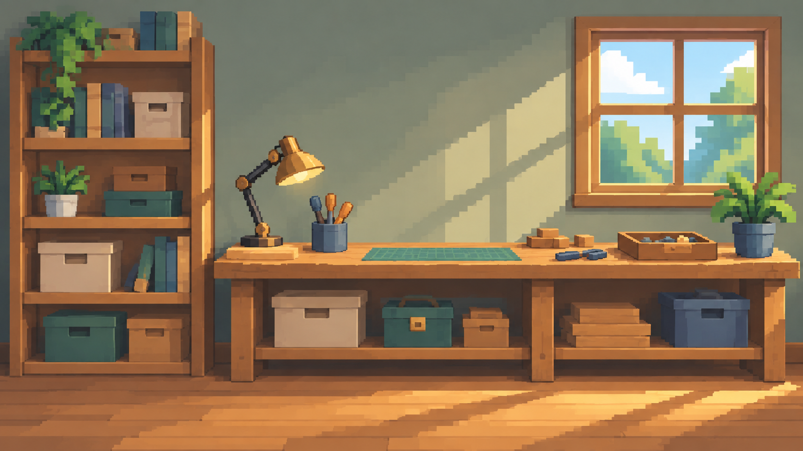
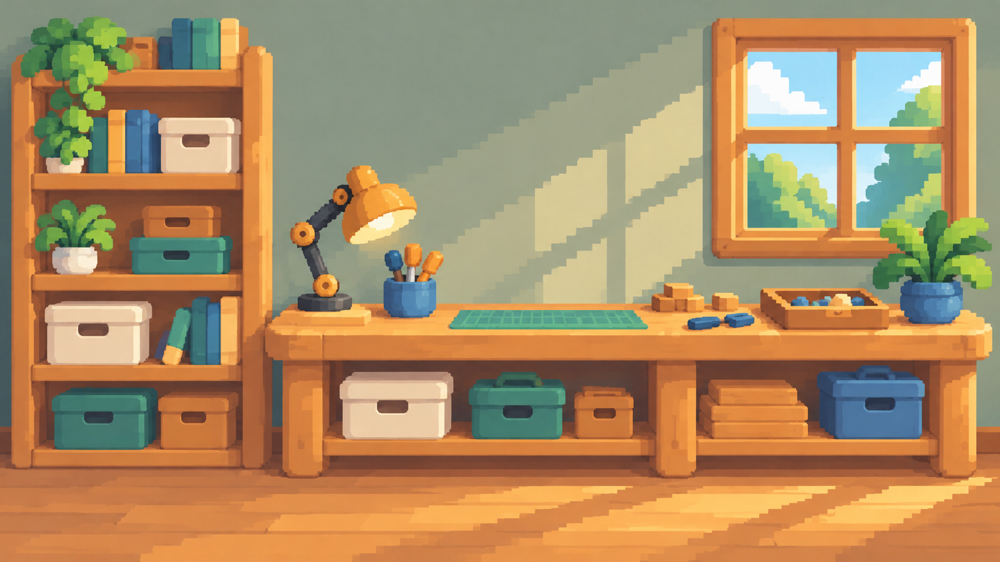
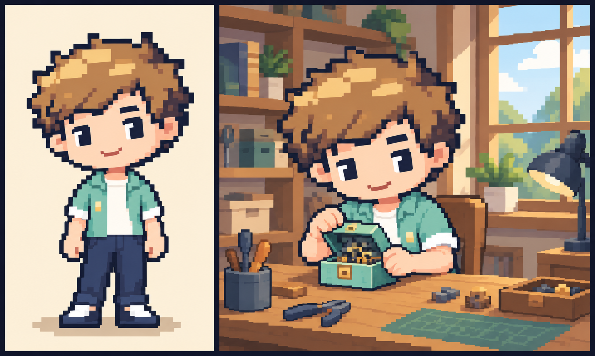
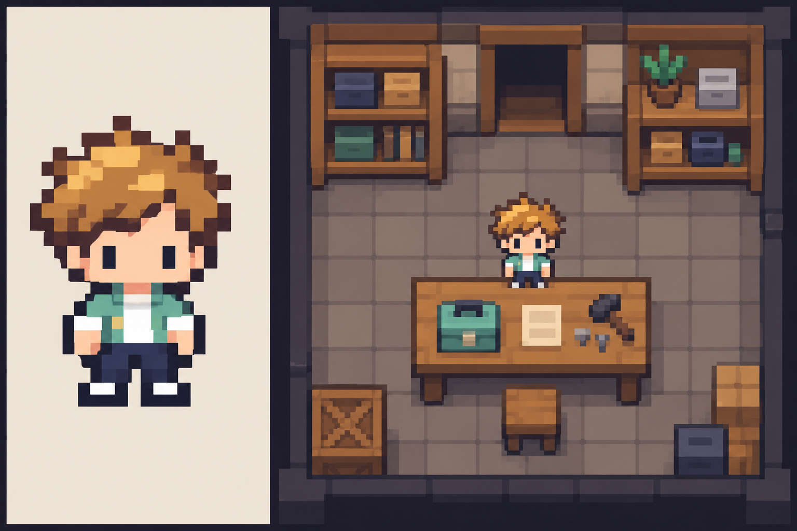
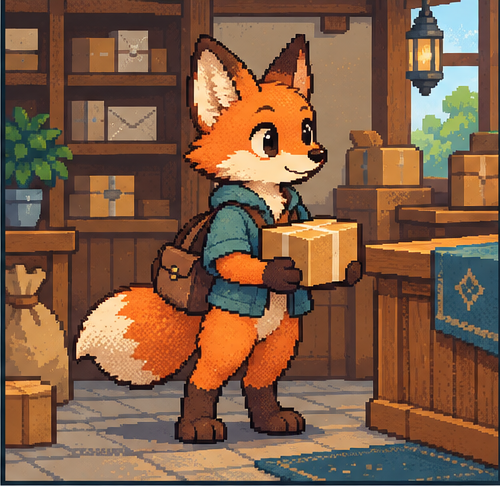
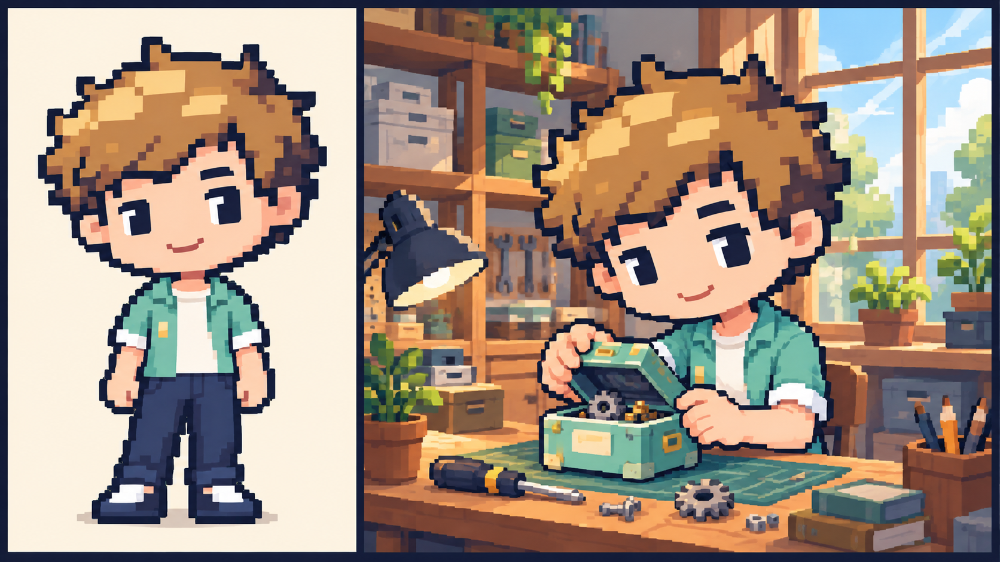
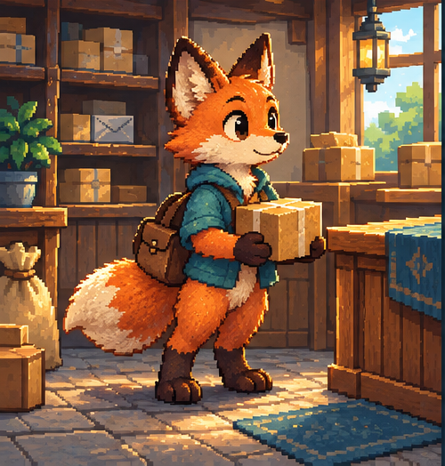
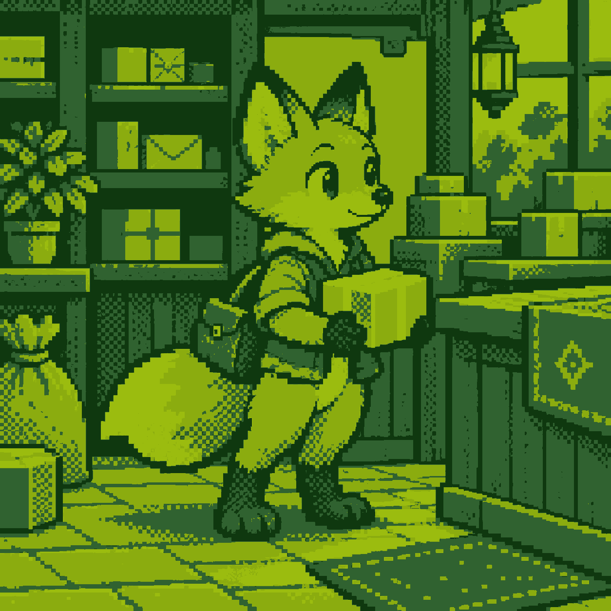
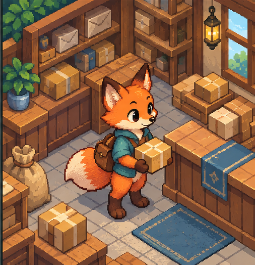

# 八类场景画风

项目主画风与片段特选共同遵守 [透传合同](ART-DIRECTION-CONTRACT.md)。每片段只有一个有效画风，人物、其他物种、背景、道具全部跟随；组件独立，字幕另行排版。

[可视画廊与完整提示词](references/index.html) · [唯一规范目录](art-profiles.json) · [参考来源与哈希](references/sources.json)

八类画风方向与原物种样板已获用户正向确认。可爱、粗像素及超粗精灵画法另附 [小棕参考](../library/characters/style-variants/README.md)，超粗版静态效果已获认可，可爱与粗像素试样状态分别记录；不替换原V3。可爱与粗像素另补完整干净背景候选，待审美确认；其他分支局部观察图仍不是独立背景、透明角色或道具资产，不新增动画认可。历史原图与生成提示词保留在 [原始样板记录](../library/characters/design-atlas/sources.json) 和 [补充记录](../library/characters/design-atlas/additional-sources.json)。

本页由 build-art-reference.cjs 从目录生成，修改描述请回改 art-profiles.json。当前 v3 已细化八类核心描述及人物、物种、道具分支；画风定义不绑定具体人物，物种按自身结构概括，道具保留用途和接触。此次更新描述，已有图像仍按原来源与认可范围使用。普通画风不强制深色或固定头身比；粗细、限色和投影可组合，但组合必须在项目/片段层形成一套完整规范后统一传给四分支，不能在分支各自混搭。未登记的新组合先写齐通用与分支要求，并做整体试样，不把现成单项参考当作组合已生成。

## 完整背景对照

八类是完整画风方案，名称强调的维度不同；七项维度用于明确方案，不是人物、背景各自换画法的开关。新组合先在项目或片段层写齐并统一验证，不能仅凭现有单项参考视为组合已制作。

可爱与粗像素新增同一工坊、相近视角和布局的完整干净背景，观察颗粒、形状、细节、色阶与光影差异；这是整套方案对照，不能据此归因单一维度，生成图也不宣称逐像素注册。工坊、日光、配色和留白只属于此样例。

**粗像素**

新增完整背景对照，已做静帧检查，待用户审美确认；人物样板与背景分别制作，旧裁片只作历史观察，工坊内容与布局不成为默认。

**可爱比例**

新增完整背景对照，已做静帧检查，待用户审美确认；人物样板与背景分别制作，旧裁片只作历史观察，工坊内容与布局不成为默认。

[背景对照的提示词、来源与哈希](references/background-comparison/sources.json)。其他六类仍以现有整景和局部观察为参考，不声称已制作完整干净背景。

## 粗像素（chunky）

以大像素簇和少量硬边明暗面概括形体，轮廓台阶清楚；保留辨认与操作所需的结构，压低表面碎纹。像素感来自造型组织，不靠马赛克滤镜。

| 维度 | 画法 |
| --- | --- |
| 颗粒 | 大像素簇，轮廓台阶清楚；按最终占画尺寸控制有效颗粒 |
| 形状 | 块状结构，主要体积用大面概括 |
| 细节 | 低至中等密度，优先保留辨认与操作结构，减少碎纹 |
| 色阶与配色 | 每种主要材料使用少量离散色阶，色相按项目决定 |
| 轮廓 | 硬边阶梯轮廓，避免细长孤立像素 |
| 光影 | 大块受光与阴影，靠明度组和遮挡分层，无柔焦光晕 |
| 投影 | 按镜头选择可信视角，同镜统一，不固定为某种相机 |

**选用建议**：常用：日常知识解释、直接清楚的情境比喻、物体关系和动作演示。用清楚轮廓、大色块与适量细节保持可读性。

- **人物**：按身份基准保留脸型、发型剪影与服装主色块；眉眼用少量清楚色块表达，发束和衣褶合并成大面。头、躯干、四肢和手掌采用一致的概括程度；手势先看整只手的朝向和接触，不逐根刻画手指，也不把四肢画成细长孤立像素。
- **其他物种**：以大像素簇概括吻喙、耳翼、壳、尾或叶冠等物种识别结构，毛羽与鳞片合并为大面。先确定自然体态或拟人体态；移动和取物由本物种实际可用部位完成，不能把人类手掌贴到翅膀或触手末端。小尺寸仍看得清身体朝向、支撑与接触。
- **背景**：墙、建筑、家具和植被以大块分区；木面省略细木纹，叶片归纳为少量块状组；前中后景靠遮挡和明度组分清，保留落脚面与承托面。
- **道具**：先画能辨认用途的外轮廓，再用少量硬边色阶区分顶面、侧面和开口；把手、按钮、铰链等只保留实际需要的操作结构。木、金属、布或纸靠大面受光与边缘区分，省略细纹和装饰小零件；抓握处、承托面与可动件连接清楚。

## 更粗像素（more-coarse）

比粗像素进一步放大有效像素簇，以更少的体块、轮廓转折和色阶保留对象剪影；省略装饰与碎纹，开口、通路和关键接触仍可辨。不加柔焦、细描边或噪点。

| 维度 | 画法 |
| --- | --- |
| 颗粒 | 比粗像素更大的有效像素簇，不用缩图滤镜冒充简化 |
| 形状 | 更少的块状形体，剪影优先 |
| 细节 | 很低密度，省略装饰、细缝与表面纹理 |
| 色阶与配色 | 比粗像素进一步减少色阶，分清关键明暗面 |
| 轮廓 | 短而明确的阶梯边界，省略亚像素线 |
| 光影 | 少量硬边明暗块，避免噪点与渐变 |
| 投影 | 随镜头统一视角，简化细节仍保留遮挡与接触 |

**选用建议**：按具体表达需要选作项目主画风或片段特选。

- **人物**：身份优先保留发型外形、脸部特征位置和服装主色块；眉眼、手和鞋各归纳为少量完整块面，删去碎发、细衣褶和手指缝。姿态用躯干倾向与四肢剪影表达；接触动作保留清楚的手与物边界，需要更细操作时调整景别。
- **其他物种**：吻喙、耳翼、尾壳或叶冠只保留主要外形与朝向，减少内部线条。自然或拟人体态先选定；保留足、爪、腕足或根等支撑和操作关系，多肢重叠处用遮挡分清，不能因省略细节改变既定身体结构。
- **背景**：建筑、窗、山体和货架进一步归并为少量大块；省略细小装饰和表面碎纹，门窗开口、通路、地面与主体落点仍可辨。
- **道具**：把物体归纳为主体、开口和操作部位几个大块，减少缝线、齿纹与装饰。外轮廓与抓握空间比表面纹理优先；关键孔口或按钮太小时改景别或简化操作，不把高精度产品图缩贴进粗颗粒场景。

## 超粗像素（ultra-coarse）

参考《元气骑士》一类游戏内小尺寸精灵的概括方式：极少的大像素簇、紧凑剪影和离散色块表达对象、状态与空间关系。无柔焦、连续渐变和亚像素细线；逻辑分辨率与颜色数按项目决定。

| 维度 | 画法 |
| --- | --- |
| 颗粒 | 小尺寸游戏精灵式的大像素簇，不固定全项目逻辑分辨率 |
| 形状 | 紧凑、符号化，以少量色块保持对象识别 |
| 细节 | 极低密度，只保留身份、功能和动作关系 |
| 色阶与配色 | 少量离散色块，颜色数量按项目决定 |
| 轮廓 | 清楚剪影和块状台阶，无亚像素细线 |
| 光影 | 极简硬边明暗，以可辨性优先，无柔焦和连续渐变 |
| 投影 | 随镜头选择简明一致的空间方向，关键落点可辨 |

**选用建议**：适合精灵式角色、小尺寸行动与极简场景演绎；以《元气骑士》的游戏内小角色概括程度为参考，不参考高精度宣传立绘，不把该游戏角色、服装或关卡直接复制到项目。

- **人物**：不以头身比或精细人体比例验收。允许头身压缩、短躯干和高度符号化的四肢手脚；用身份参考中的发型剪影、主色块和服装标记识别角色，不把该参考的完整身体比例硬套到精灵。朝向、动作和对象关系在实际小尺寸下可辨，不能只放大一张立绘冒充游戏内精灵。
- **其他物种**：以极少色块保留最关键的物种剪影，如耳尾、喙翼、壳、触手或叶冠；不套人类头身比例，也不要求绘出被遮挡的全部细小关节。按自然或拟人方案保持支撑、移动、取物与身体结构连续；简化不能无意增加肢体或使动作对象混成一团。
- **背景**：场所只保留辨认与解释所需的大块结构，家具和建筑符号化；不以细纹填补空白，保留关键遮挡、通路、承托与落点。
- **道具**：用少量色块区分主体、功能开口与状态；工具能被握住、物体能被承托，关键接触处不与持有者粘成同一色块。无需画出所有按钮或机械细节；小尺寸无法辨认的结构改景别或重设动作，保留同一道具的身份色块与状态连续。

## 经典冒险（classic）

中等像素颗粒组织完整而概括的体积，硬轮廓克制，主要材料各有分组明暗；局部可用有序抖色，结构、动作和阅读层级优先于装饰纹理。

| 维度 | 画法 |
| --- | --- |
| 颗粒 | 中等像素颗粒，统一轮廓和材质的有效尺度 |
| 形状 | 完整但概括的体积与功能结构 |
| 细节 | 中等密度，有序材质细节，不逐面填纹 |
| 色阶与配色 | 主要材料分组色阶，可有克制的有序抖色 |
| 轮廓 | 克制硬轮廓，台阶走向清晰 |
| 光影 | 主光明确、接触影清楚，体积和阅读分层 |
| 投影 | 随镜头选择统一视角，保持空间与比例可信 |

**选用建议**：按具体表达需要选作项目主画风或片段特选。

- **人物**：沿身份基准统一头肩、躯干与四肢比例，用清楚像素面区分脸型、发束、衣领和手势。衣褶与发丝只留支持体积的主要转折，表情靠眉眼和嘴形变化，动作保留重心、关节方向及抓握接触；不因新表情换脸或换体型。
- **其他物种**：保留本物种的身体比例和关节逻辑，用中等颗粒表达吻喙、翼壳、尾与肢体的连接；自然或拟人方案统一。毛羽和鳞片采用有序少量纹理，支撑、飞行或取物姿态先看结构与接触，不给所有物种套同一双手或同一身体。
- **背景**：以分组色阶组织建筑和前中后景，家具开口、边缘与支撑关系清楚；只在有用位置增加适量材质和有序抖色，主阅读区保持安静。
- **道具**：外形、开口、连接和主辅材质清楚，厚度按用途分配；握持区、承托面与活动部件有可信接触。用分组明暗表现木、铁、纸或玻璃，只在需要处加纹理和接触影，抖色不抢过功能结构。

## 可爱比例（cute）

以亲和圆润的形体、柔和明亮的协调色组与简洁块面阴影建立轻松感；曲线仍由清楚的硬边像素台阶表达，材质细节从简，保持可信空间。可爱程度与像素粗细分别说明。

| 维度 | 画法 |
| --- | --- |
| 颗粒 | 中等清晰像素簇；可爱造型不等于自动放大颗粒 |
| 形状 | 亲和、圆润的整体形状，以硬边像素台阶表达曲线 |
| 细节 | 低至中等密度，材质简洁，保留用途与承托结构 |
| 色阶与配色 | 柔和明亮的协调色组，材料用少量离散色阶 |
| 轮廓 | 清楚而简洁的阶梯轮廓，不用平滑矢量曲线 |
| 光影 | 简洁块面阴影，光线层级柔和但边界保持像素感 |
| 投影 | 按镜头选择可信视角，家具与环境不套人物比例 |

**选用建议**：常用：轻松、亲和、人物互动、情绪表达和故事类解释。大头短肢与手脚统一，背景与道具保持简洁亲和。

- **人物**：大头短肢统一造型，头、颈肩、躯干、手脚按同一可爱比例绘制，禁止成人写实肢体拼幼态头脸。手脚紧凑完整，服装随体型简化；表情可强调眉眼与嘴形，但保留身份脸型、发型和服装标记，不让不同角色变成同脸。重心、手与物的接触仍清楚。
- **其他物种**：以圆润剪影、简洁五官和紧凑体块表现亲和感；适合头身区分的动物可用大头短肢，鸟、章鱼、植物等按自身结构概括。吻喙、翼壳、腕足或叶冠保留识别，自然或拟人体态统一；不为卖萌给所有对象加人类手脚或拼上人脸，支撑与操作方式仍可信。
- **背景**：背景结构简洁亲和，转角与植物轮廓适度圆润；墙面和木面减少碎纹，尺度与主体兼容。建筑和家具保持可信空间、承托与遮挡，不模仿人物身体比例。
- **道具**：轮廓转角可适度圆润，材质用简洁色面表达；把手或操作区可按动作需要放大，不能将所有器物都变成鼓胀玩具。开口、厚度、抓握和承托关系保持可读，不默认给物体加脸，也不为可爱而增加无关装饰。

## 细节叙事（detailed）

用较细而有组织的像素簇、选择性轮廓和丰富分组色阶表现材料与叙事细节；细节集中在焦点和有用结构，非重点区降低密度。保持离散像素面，避免柔焦、随机颗粒和连续渐变。

| 维度 | 画法 |
| --- | --- |
| 颗粒 | 较细且有组织的像素簇，仍保留可辨的像素形体 |
| 形状 | 体积完整，结构与材料差异明确 |
| 细节 | 较高但选择性的密度，焦点区优先，非满屏细纹 |
| 色阶与配色 | 丰富而分组的离散色阶，避免连续平滑渐变 |
| 轮廓 | 选择性硬轮廓，避免所有物体同样粗描边 |
| 光影 | 明确材料受光与局部光，避免所有边缘发亮 |
| 投影 | 按镜头统一相机与空间关系，不默认固定场所 |

**选用建议**：按具体表达需要选作项目主画风或片段特选。

- **人物**：在既有身份与整体比例上细化面部转折、发束、衣料和表情，细节集中于本镜焦点；非重点区合并色面。手掌、关节和服装遮挡完整，新增纹理不改变脸型或肢体长度；保持有组织的像素簇，不靠写实照片缩图制造细节。
- **其他物种**：按真实或明确设计的物种结构细化毛羽、鳞壳、关节或叶脉，纹理沿身体体积和生长方向组织。自然或拟人体态保持一致；先核对数量、连接与支撑，再加局部表情和材料细节，不能让纹理掩盖结构错误或把所有物种画成人脸。
- **背景**：用结构、材质与局部光塑造前中后景；焦点附近保留有用纹理，文字区和非重点区降低密度；不以满屏亮点制造精致感。
- **道具**：优先细化用途相关的开口、连接、操作部位与使用状态；磨损出现在实际接触区，反射随材料和主光变化，不能每条边都发亮。非重点表面降低纹理密度；状态变化保留同一道具的结构、材质与尺寸，不凭装饰增加新功能。

## 复古掌机限色（four-tone）

整段情境严格共用四种不透明颜色，以明度组、轮廓、负形和局部有序抖色表达体积；颜色承担结构区分，不额外增加渐变、半透明高光或抗锯齿中间色。具体四色按项目决定。

| 维度 | 画法 |
| --- | --- |
| 颗粒 | 统一可辨像素尺度，限色本身不决定颗粒粗细 |
| 形状 | 轮廓和负形组织体积，关键结构先可辨 |
| 细节 | 以明度关系表达细节，抖色有序且服务阴影 |
| 色阶与配色 | 全情境严格共用四种不透明颜色，具体四色按项目定 |
| 轮廓 | 用明度对比和硬边轮廓区分相邻对象 |
| 光影 | 只用约定四色表达光影，无额外渐变色 |
| 投影 | 按镜头统一视角，限色不自动改变投影 |

**选用建议**：按具体表达需要选作项目主画风或片段特选。

- **人物**：脸、发型、服装和手势使用同一四色表；以负形和明度边界保留身份标记，五官与手部避免粘连，表情不靠新增颜色。抖色不覆盖关键五官或接触处；与背景同值时调整块面与构图，不临时增加轮廓色。
- **其他物种**：吻喙、翼尾、壳、腕足或叶冠用同一四色表的剪影与负形区分；同值重叠处调整遮挡和明度，不增加第五色描边。自然或拟人体态先确定，数量、身体连接与实际操作方式不因限色而随镜变化。
- **背景**：建筑、地面、家具和远景共用同一四色表；用负形、明度组与遮挡分层，主体区避免同值粘连；抖色仅服务体积和阴影，不制造随机噪声。
- **道具**：主体、孔口、把手和承托面使用同一四色表，用轮廓、明度和负形区分用途与开合状态；不同材料只保留必要线索，避免密集抖色淹没功能结构。静态母图按实际像素核验四色，新增状态也沿同一色表制作。

## 等距空间（isometric）

统一正交等距投影，中等像素颗粒与离散色阶组织有高度和厚度的体块；地面主轴约2:1阶梯，无透视消失点，同镜对象共享轴线、主光和遮挡顺序。

| 维度 | 画法 |
| --- | --- |
| 颗粒 | 中等像素颗粒，地面轴线台阶节奏一致 |
| 形状 | 有明确高度和厚度的概括体块 |
| 细节 | 中等密度，服务空间布局与对象关系 |
| 色阶与配色 | 分组离散色阶，色相与气氛按项目定 |
| 轮廓 | 硬边轮廓，等距主轴约2:1阶梯 |
| 光影 | 同一主光、接触影和高度遮挡顺序 |
| 投影 | 统一正交等距投影，无透视消失点，家具地面共享轴线 |

**选用建议**：主题关联：优先用于游戏模拟、模拟经营、物流与资源调度、空间布局和协作系统；按空间关系是否有助于解释来选择，不要求所有游戏题材采用等距。

- **人物**：按等距相机重绘朝向、头部可见面、躯干与脚底，保留身份和既有身体比例；脚落在地面或支撑物的正确高度。手臂伸向物体的实际接触面，前后肢体按深度遮挡，不把正面立绘简单倾斜后贴上地面。
- **其他物种**：按同一等距相机表达身体朝向、翼尾、壳和前后肢体的深度；足、爪、腕足或根与对应支撑面处于正确高度。自然或拟人体态及操作方式保持一致，移动、飞行和取物都遵守遮挡关系，不把正面物种图直接贴到等距空间。
- **背景**：建筑、地面、家具沿同一组正交等距轴线，主轴约2:1阶梯；无透视消失点，统一高度、厚度、遮挡和承托关系，避免单件家具另用产品透视。
- **道具**：桌、箱、工具的长宽高沿同一组等距轴线，顶面、侧面、开口与厚度随相机成立；支脚、铰链和活动部件有明确连接。放置与握持匹配实际接触面和高度，旋转或开合后保持投影一致，不独自换成透视产品图。

## 样板的使用范围

原狐狸的粗像素、经典冒险、可爱比例、细节叙事和等距样板从已确认六格图按单格提取并保留；两种常用画法的主展示另补小棕试样，属于待确认候选；更粗使用独立原图；超粗主展示已换为小棕游戏精灵新候选；原40×40八色狐狸留作历史颗粒参考，不是最新小棕效果，也不将其参数套给新图；掌机使用已检查的严格四色图。40格、八色、橄榄绿和快递站题材仅属于相应样例，不固化到所有新镜头。

新主题先设计内容与空间，再附适用样板；不把狐狸、书架、窗口、包裹或原布局逐片复制。人物、其他物种与整景制作继续检查比例、连接、肢体数和接触。
