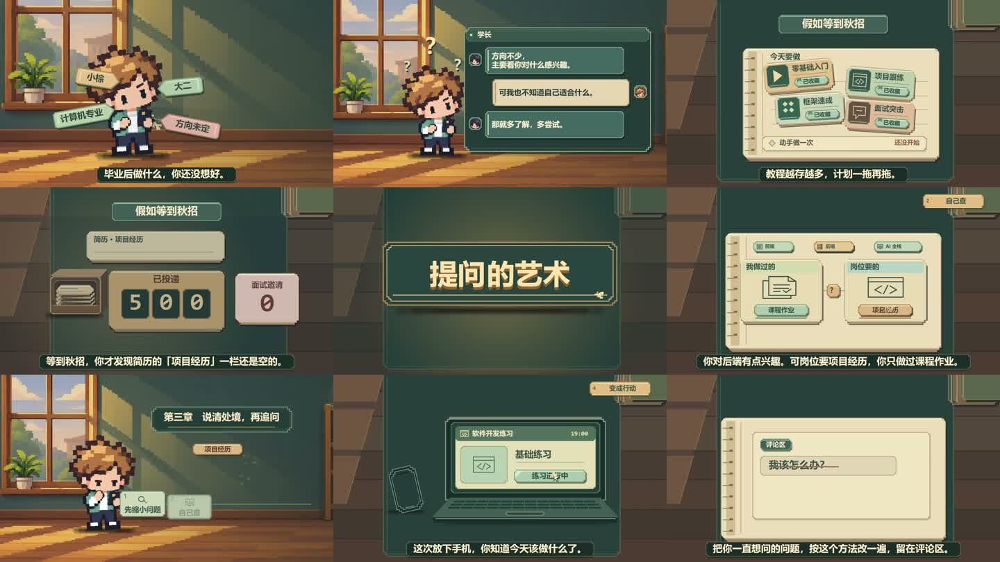

# 当前系列风格：人物表演与像素信息动效

本视频系列的新片默认沿用《提问的艺术》R38《步进》V5 的表现方法。用户指定风格、当前项目已确认方案优先。88 秒、原片人物姓名、房间、台词和配乐长度只属于参考片，不作为新片模板。

[完整有声参考与八段选段](../examples/asking-motion/index.html) · [逐镜动作与拍点](asking-motion-reference.md) · [来源与哈希](../examples/asking-motion/source.json)

上图来自同版 MP4 的九帧，只用于观察构图与画风；动作顺序查动态参考，不能由静帧推断已完成动作审查。

## 人物、环境与组件怎样同框

| 层 | 当前做法 | 制作依据 |
| --- | --- | --- |
| 人物 | 超粗像素游戏精灵，大头短身、大色块与清晰阶梯轮廓；少量完整姿态表达疑惑、关注、确认与行动。保持发型、服装主色和朝向，姿态变化须回应事件。 | [人物素材](../modules/library/CHARACTERS.md)、[整幅姿态](../modules/scenes/character-performance/README.md#整幅姿态试样) |
| 环境与实物 | 比人物更丰富的粗像素空间，前中后景、暖冷受光与支撑面可辨，降低非重点细节；场所按题材设计。人物与环境可采用明确的颗粒分工，统一光源、接触和投影。 | [美术合同](../modules/style/ART-DIRECTION-CONTRACT.md) |
| 组件 | 以可操作的纸签、纸页、聊天窗、按钮、托盘或计数装置承载信息。硬边轮廓、薄边或必要侧壁、少量离散明暗面。米色纸、深绿底、暖金重点和浅绿确认是本参考的配色职责，换题材可另定色表。 | [组件美术](../modules/style/COMPONENT-ART.md)、[按内容设计](../modules/components/DESIGN.md) |
| 文字 | 主句、对象标签、数值分层绘制；中文以清晰阅读为先，组件外观与粗像素人物不要求中文逐字像素化。落稳再读，主句不与对象同义复述。 | [文字表现](../modules/text/EXPRESSION.md) |

已有八类画风、精细 V3 人物和机械／能量组件供明确需要时选用，不作为新片自动选型；姿态目录中的示意图也不充当正式人物。新片使用本片实际素材，不能把参考包中的原片人物和场景直接接成新片。

## 把“动感”落实为事件

- **先有因果。** 消息到达再出现反应；手／脚／指针触到对象，再变更组件状态。人物可以读、等、思考，不以全程摇摆或反复歪头、抱头、摊手表示生动。
- **短促动作，稳定结果。** 起动、接触、回弹收束分开；位移和镜头逐帧求值，少量姿态允许抽帧切换。离散动作的起点见 [TIMING](../modules/motion/TIMING.md)，阅读不够就留末态，不能把飞入拖长。
- **冲击集中。** 短闪、衰减震动、扫亮、像素碎屑用于关键接触或揭示，范围以焦点对象为主，随事件收束。不要同时放大人物、卡片、字幕和整幅相机。
- **焦点接力。** 先让一个结果读清，再交给下一个；参考中的“纸堆 → 500 → 0 → 回复气泡”保留投入与结果，气泡退到次级。相机推近／拉宽要让观众看清新的关系。
- **同物接镜。** 交出、在途、接住保持身份；可让标题缩成页眉、待办条接成下一页空栏、标签离卡进入下一场。对象与环境共同交接，遮挡层先后明确，结果落稳后再展开文字。
- **配乐落在看见变化的帧。** 先锁当前音源与真实起音，再倒排动作；大转折用乐句和重拍，成组组件用细分拍。原片 120 BPM 的网格可作观察，不复制原片绝对秒数。

参数与能力从 [motion](../modules/motion/GUIDE.md) 查询，原片快照仅证明该片呈现过这些效果，不表示全部效果已注册为通用 recipe。

## 开新片与验收

新片从空工程与本次文案出发，项目路径显式传给工具。先做含人物反应、组件操作、一次交接和稳定阅读的代表片段；只加载本镜需要的实现与素材。旧工程、历史画风候选、缓存页面均不作为新片的初始化源。

在实际占画尺寸核对人物身份和触点、组件材质与遮挡、文字和主次。正速带声核对动作及接镜，再按 [工作台](workbench.md) 导出可编辑分轨与同次 MP4／项目 JSON；未播放的项目标未审。复用原片的叙事机制，不继承原片审片结论。

维护参考包时，可运行 `node tests/asking-reference-browser.cjs CHECK_OUTPUT`；需按 [运行说明](runtime.md) 提供可用的 Playwright 与浏览器，输出目录须在技能包外。该检查覆盖独立加载、八段跳转、逐帧往返和音轨播放，不表示全片审美或听觉验收。
