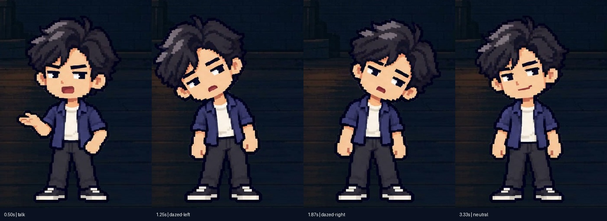

# AI 是否摧毁了计算机行业｜32 秒插图版

> 历史样例，人物与导航方案已被后续反馈撤回。保留原始源文件与核验记录用于复盘，不能直接当作新片默认模板。插图素材可按需要复用；姓名条、配角开场口播、多全身姿态切换、细线串点进度条均不符合当前 [计算机口播要求](../../references/computing-voiceover.md)。新的讲述方案应由单一主角固定姿态只做局部开闭嘴，顶部使用实心矩形进度条。

本例当时将配角放入开场讲述者槽位，主角从后续接话，并用 storyboard.performance 轮换全身姿态；这些安排已撤回。三张实际生成的像素插图承担 AI 批量处理、重复订单和验证交付，仍保留作为插图方法参考。

当时的顶部导航为细线串点，阶段为疑问、工作变化、产品问题、系统职责、验证、交付。当前文字模块已改为实心矩形推进；重新构建后不再与下面的历史抽帧完全一致，旧核验不能证明新构建通过。

下面是本次实际 MP4 的解码抽帧，非制作提示词或美术概念稿：




此前画面版本的核验范围见 [validation.json](validation.json)，技术及文字抽帧检查、自动播放与主观视听状态分开记录。该记录及上述解码帧来自加入配乐前的成片；当前新增 BGM 需重新 build/render 和听音核验。

本例的 `production-plan.bgm` 已选定 Kevin MacLeod《Chill Wave》，音量0.18、旁白期间保留25%，淡入60帧、淡出90帧。完整原曲随基础 skill 提供，先用下列 `import-bgm` 命令生成项目 PCM WAV；无需重复下载或把整份 WAV 跟踪进样例。发布时保留曲目来源与 CC BY 4.0 署名，具体见基础层 `modules/audio/MUSIC.md`。

四份 JSON 是创作源；`scene.js` 为本例的插图标注动画，读取 script.labels 和 storyboard.events，不另定时间。`media/illustration-provenance.json` 保存内置 imagegen 的素材来源与提示词规格；三张 PNG 和十二段已确认脚本文字的本地合成旁白随例分发。它们是教学示意，不是就业数据或真实订单故障记录。

先配置基础 skill 的 Node、Playwright、浏览器、FFmpeg 与 Python 依赖，可复制本目录到本地 work 目录后执行：

```text
node render-media.cjs
python FOUNDATION/scripts/video.py import-bgm PROJECT
python DIRECTOR/scripts/director.py check PROJECT
python DIRECTOR/scripts/director.py handoff PROJECT --foundation FOUNDATION
python FOUNDATION/scripts/video.py render PROJECT/video --name ai-industry-illustrated
node FOUNDATION/tests/presenter-progress.cjs PROJECT/video EVIDENCE
```

`DIRECTOR/FOUNDATION/PROJECT/EVIDENCE` 为使用者选择的目录占位符。Node 依赖可通过 PIXEL_NODE_MODULES 定位。媒体动画为 30fps，成片与人物/进度层为 1920×1080、60fps。生成 MP4、逐帧缓存、运行依赖和本片 Review 放忽略目录。技术、抽帧、连续观看和听音分别记录，不继承旧版审片结论。
